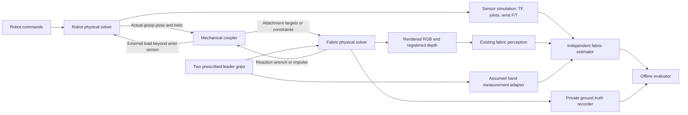

# Fabric state estimation against a simulated physical world

Prepared 2026-11-05. Scope: architecture, current gaps, solver coupling, and an implementation roadmap. This is a source audit and design report; it does not claim a completed coupled simulation or an estimator accuracy result.

The selected material is dry woven carbon fabric without resin. See the [carbon fabric material and appearance plan](CARBON_FABRIC_MATERIAL_PLAN.md) for reference products, available assets, constitutive-model limits and calibration steps.

## 1. Recommendation

**Compute grasp reactions in the fabric plant, transfer them through a small mechanical interface to the robot plant, and let an independent estimator observe simulated sensors.** Keep the fabric physics reusable here, robot dynamics and sensor mounting in `oarbot_simulation`, and inference in `oarbots`. Run the two physical solvers in one synchronized simulation process when testing their mechanical interaction. The estimator can remain a separate ROS process.

For the first experiment, use prescribed robot grip trajectories and camera observations, with force fusion disabled. This is already a useful state-estimation test. Next validate fabric reaction extraction, then load the simulated robots and validate their wrist sensors. Enable force fusion only after its measurement model agrees with the grasp interface. Full finger friction, a human body, and general robot–cloth surface contact are unnecessary for the initial task.

Corner force belongs in a standalone fabric simulator as an **output reaction**, even when there is no robot model. It becomes an **input load to robot dynamics** when a simulated robot is connected. It is not an additional arbitrary force to apply to an already prescribed corner. With real robots and real fabric, nature supplies the coupling and the wrist sensor measures it; simulated reactions remain useful for prediction and validation, but should not be added to the physical interaction.

## 2. What the inspected code actually does

Snapshot: fabric `0c4df2a`, local `oarbots` `6f17744`, robot simulation `aa78814`, and vendored legacy `Assistive-Robotics` `eefd049`. These repositories are being worked on independently; the observations below describe the files inspected for this report, not future changes. The robot simulation's source manifest pins an older `oarbots` snapshot (`afa80b9`), so its vendored description and the active estimator checkout must be tracked separately.

| Component | Observed behavior | Consequence |
| --- | --- | --- |
| [Fabric model](fabric_newton_isaacsim.py) | Newton Style3D cloth, 56×56 cells / 57×57 particles by default, four 3×3 pinned patches, ground and static table | Useful physical plant, with ideal prescribed holders |
| [Cloth stepping](capsule_cbf/newton_runtime.py) | Patch particles are inactive; positions and velocities are overwritten each substep; forces are cleared before stepping | No dynamic gripper and no exported attachment impulse |
| [Current tension calculation](capsule_cbf/cloth_model.py) | `resultant()` sums internal stretch and bending forces on a patch; the controller reports their norm | Useful tension diagnostic, but not a complete dynamic wrist wrench |
| [Combined robot scene](/media/taha/ExtermeLinux/oarbot_simulation/scripts/run_oarbot_fabric.py) | Robots advance first; follower patch velocities are chosen to end at measured tool positions | Existing one-way mechanical coupling; fabric does not load the arms |
| [Grasp helper](/media/taha/ExtermeLinux/oarbot_simulation/oarbot/fabric_coupling.py) | Transfers tool displacement into patch velocity | Patch currently translates in world axes rather than rotating with the tool |
| [Wrist sensor](/media/taha/ExtermeLinux/oarbot_simulation/oarbot/ft_sensor.py) | Reads the incoming joint wrench at the configured sensor link | Robot-side sensing exists, but the cloth must first exert a real solver load |
| [Estimator](/home/taha/ros2_colcon_ws/src/oarbots/src/fabric_state_estimator/fabric_state_estimator/node.py) | Uses perception observations, capture-time TF for two robot grips, two hand states, and optional calibrated forces | It already supports the intended sensor-only architecture |
| [Estimator physics](/home/taha/ros2_colcon_ws/src/oarbots/src/fabric_state_estimator/fabric_state_estimator/newton_backend.py) | Independent ensemble worlds, four point pins, no obstacle/self-contact, quasi-static force prediction | Contact and finite grasp patches are model mismatches that need explicit treatment |

The current cloth controller reads full particle state inside the plant. That is acceptable for an **oracle-controlled estimator benchmark**, but it is not evidence of a controller operating from estimated state. Label those experiments separately.

The existing robot integration report also explicitly identifies missing fabric reactions, world-axis patch offsets, missing robot state/clock publication in the combined mode, and anchored bases. Its historical timing and validation results are prior evidence, not measurements repeated for this report: [FABRIC_INTEGRATION.md](/media/taha/ExtermeLinux/oarbot_simulation/FABRIC_INTEGRATION.md).

## 3. Three models with different responsibilities



The plant owns the physical cloth state. The robot solver owns robot dynamics. The estimator owns a separate uncertain cloth model corrected using measurements. The estimator model must never act as a second physical cloth that pushes the simulated or real robot.

Use one physical cloth instance in the combined scene. Do not run the standalone cloth world and the robot scene's vendored cloth as two authorities. Separate processes are possible, but then need a step coordinator, timestamped exchanges, and bounded latency; ordinary asynchronous ROS topic exchange is a poor first choice for a stiff mechanical loop.

## 4. Challenging the attachment-force proposal

Transferring forces at attachment points is mechanically appropriate for this task. The limited contact area is an advantage: the interface can be a handful of grasp patches rather than the entire cloth surface. Several conditions determine whether it is a useful approximation.

### A. Transfer a wrench from a physical patch

A single point attachment transmits force but has no independent resistance to rotation. A finite clamp patch can transmit a resultant force and a moment. Start with a small no-slip clamp patch, rotate its offsets with the tool, and recover the load on that patch. If measured grasp behavior is closer to a freely pivoting pinch, reduce its rotational constraints instead of inadvertently modeling a rigid weld.

For grasp origin `G`, local patch offsets `r_i`, tool pose `(p_G, R_G)`, and twist `(v_G, omega_G)`:

```text
x_target_i = p_G + R_G r_i
v_target_i = v_G + omega_G × (R_G r_i)
```

Select patches by a size in metres, not a fixed particle count. Today's 3×3 patch spans about 3 cm on the 1.5 cm grid; a 3×3 patch on another resolution has a different mechanical size.

### B. A pin hides a reaction; it does not eliminate it

Define `lambda_i` as the attachment force **on the cloth**, and all other forces on that particle separately. The mechanical balance is:

```text
lambda_i = m_i a_i - f_internal_i - m_i g - f_contact_i - f_other_i

F_cloth_on_robot = -sum(lambda_i)
tau_G = sum((x_i - p_G) × (-lambda_i))
```

In a settled, contact-free case, internal patch forces are a useful starting approximation. Dynamic recovery also needs acceleration, held cloth mass, contact, and any other loads. Define whether pinned material mass remains in the cloth budget; account for it exactly once. Inactive particles in the current solver do not receive ordinary gravity integration.

Prefer solver-consistent attachment multipliers, impulses, or the converged constrained residual. The current runtime does not expose a constraint impulse just because particles are pinned. `particle_f` is an external input buffer, not an accumulated internal-force sensor; the installed Style3D source adds internal forces to its solve RHS. Summing `particle_f` or observing zero pin acceleration will therefore not recover the missing reaction.

The existing `ClothMechanics.forces()` provides an initial stretch/bending operator. A new reaction routine can use it for slow, contact-free validation, then incorporate the remaining terms and the actual discrete update. Numerical velocity damping and finite solver convergence must be included in that audit; a continuous balance alone does not guarantee an exact discrete solver reaction. Initially keep obstacles away from the grasp patches so local contact contributions do not have to be inferred.

### C. Apply the load through the sensor's mechanical chain

Apply the reduced wrench to an actual hand/gripper rigid body downstream of the Rokubi measurement joint. Applying it to an upstream flange can bypass the sensor. Publishing a `WrenchStamped` alone cannot make the robot feel the cloth.

If the API applies force at the grasp point, it should generate its lever-arm moment. If it accepts a force and torque about the body COM, shift the moment explicitly. Do not do both. Mapping only to actuated joint torques with `Jᵀw` may move the robot plausibly but does not, by itself, guarantee correct fixed-joint F/T readings.

For a world-expressed wrench about `G`, sensor origin `S`, and rotation `R_WS` from sensor axes to world axes:

```text
F_S   = R_WSᵀ F_W
tau_S = R_WSᵀ (tau_G_W + (p_G_W - p_S_W) × F_W)
```

Even a point force produces sensor torque if the contact is offset from the sensor. Applying only three force components at the wrong origin loses that information.

Isaac's incoming-joint-force API reports a spatial joint wrench and supports fixed-joint F/T emulation. Its direction is defined by the articulation's parent/child convention; verify the sign with a known external load before defining the calibrated ROS topic. [Isaac articulation joint sensors](https://docs.isaacsim.omniverse.nvidia.com/latest/sensors/isaacsim_sensors_physics_articulation_force.html).

### D. Equal and opposite forces alone do not guarantee stable coupling

A hard prescribed patch is an ideal position source. If the robot is stepped first and its load applied one frame later, the combined system has a delay even when both force signs are correct. Stiff cloth, strong position drives, small effective robot inertia, and sudden motion can produce oscillation or artificial energy. The robot may show little displacement under load because its drives counteract it; that does not imply the sensor load should be zero.

Exchange impulses over matching time intervals: `J = sum(f_k * dt_k)`. Transfer `J / h` if a robot interval of duration `h` accepts a held average force. Do not apply a force once for each cloth substep and then integrate that same accumulated force again on every robot substep. Force averaging/filtering also adds delay and must be recorded.

As a consistency check, the reduced patch wrench must preserve virtual work:

```text
sum(f_i · v_i) = F_G · v_G + tau_G · omega_G
```

At a no-slip interface, the robot and cloth coupling powers cancel at a common evaluation time. A compliant interface may store spring energy or dissipate damping energy. Monitor the corresponding energy balance rather than assuming force reciprocity prevents energy creation.

## 5. Best solver coupling for the limited grasp area

| Approach | What it validates | Main limitation | Recommendation |
| --- | --- | --- | --- |
| Prescribed grips, cameras, no force input | Perception, TF, timing, visual state estimation | No robot load response | First working baseline |
| Prescribed grips plus synthetic reaction sensor | Force-informed estimator under an ideal holder | Bypasses robot mechanics and wrist sensor chain | Useful standalone cloth mode; label its sensor provenance |
| Staggered two-way patch reaction transfer | Robot load, servo tracking, wrist F/T, slow manipulation | Lag and stiffness sensitivity | Smallest useful physical integration |
| Iterated partitioned constraints / implicit compliant patches | Tighter load–motion consistency and stable stiff interaction | State rollback, convergence, and implementation cost | Preferred when the staggered baseline fails convergence tests |
| One common rigid/deformable solver | Broad physical interaction | Changes cloth behavior and invalidates existing calibration | Research alternative, not the first step |

**Recommended progression:** retain the validated Style3D plant and current robot backend, add a versioned pose/twist ↔ wrench/impulse interface, and first test staggered transfer at the robot physics interval. The current cloth frame is 1/60 s with eight substeps (1/480 s); the robot interval is 1/120 s. A starting schedule can exchange loads every robot interval with four cloth substeps. Changing frame grouping must preserve the cloth's actual integration and damping behavior, then be checked against the original trajectory.

For a lagged implementation, apply the preceding interval's reaction to the robot, advance the robot, drive the cloth along the measured/predicted boundary trajectory over the same interval, and recover the new reaction. This is explicitly an approximation. Record the lag and halve the exchange interval to test convergence. Use actual loaded robot motion rather than integrated command targets as cloth boundary truth.

If lag is unacceptable, checkpoint both solvers at the beginning of an interval. Predict boundary motion, solve the cloth, apply its reaction to the robot from the same checkpoint, update boundary motion, and repeat with relaxation until pose and wrench residuals meet tolerances. Commit only one interval. Repeatedly advancing without rollback simulates extra time; it is not a coupling iteration. Hidden solver history, controller integrators, collision state, and CUDA graph buffers must be covered by rollback. Otherwise use a smaller staggered step until a supported iterative backend is available.

For greater stability, solve attachment constraints with finite compliance or an implicit interface formulation. An explicit spring added to `particle_f` can still be unstable at high stiffness; merely calling the cloth integrator implicit does not make that external spring implicit. Keep particles active for a spring/constraint grasp and remove their hard prescription. Do not simultaneously hard-pin a patch and add a second spring grasp.

Newton documents an **experimental** coupled-solver framework with proxy and ADMM paths; ADMM includes body–particle attachment rows. The installed Newton source contains these classes and their public lazy namespace. This is worth a bounded prototype if both plants use Newton. Compatibility with this Style3D runtime, its private state, and Isaac's robot sensor outputs remains unverified; no drop-in integration is claimed. PhysX robots are outside that shared-Newton-model route. [Newton coupled solvers](https://newton-physics.github.io/newton/1.6.1/concepts/coupling.html).

Style3D itself does not integrate articulated rigid bodies. Changing the robot backend to Newton therefore does not automatically couple its rigid solver to Style3D. A VBD-based cloth is another possibility, but it would be a different plant requiring material and controller validation. [Newton solver capabilities](https://newton-physics.github.io/newton/1.6.1/solvers/index.html).

The two robot grasp ports need only two poses/twists and two six-axis wrenches. The cloth can still solve all patch particles internally; reducing a patch load to a wrench must not discard the constraints that distribute that load. Leaders remain prescribed external supports. Add local finger/palm proxy collisions only if cloth near the clamp would otherwise pass through visible geometry. General arm–cloth collision becomes necessary when an experiment actually reaches those contacts.

## 6. F/T sensing and the estimator's force model

Keep three distinct signals:

1. Plant attachment reaction: the mechanical cloth load, available privately for validation.
2. Simulated raw wrist F/T: joint reaction including downstream gripper, bracket and camera gravity/inertia, plus cloth load.
3. Calibrated cloth load: compensated and frame-defined measurement consumed by inference/control.

The robot sensor adapter currently returns raw solver reactions without compensation. A fixed tare removes only the load at its tare pose; it does not remove gravity as wrist orientation changes. Start with static poses and a known downstream mass model, then add inertial compensation for faster trajectories. Noise, bias drift, bandwidth, timestamping and saturation belong in the sensor adapter, after an ideal baseline passes.

Define calibrated output as **cloth-on-robot** force/wrench in a named sensor frame. The estimator converts it to **robot-on-sheet** force using its configured `force_on_sheet_sign: -1.0`. Do not assume the raw incoming joint wrench already follows that convention. A known 2 N downward hand load should become a compensated world `Fz = -2 N` cloth-on-robot signal after conversion; the raw joint support reaction may have the opposite sign.

The current estimator uses only force, not measured torque. Its `reactions(q, loads)` predicts a quasi-static force at each single pinned corner, including vertex gravity and residual load. It does not include grasp acceleration or sum a finite clamp patch. Consequently, directly feeding a dynamic 3×3-patch reaction to this factor would introduce systematic mismatch.

Initially keep `use_forces: false`. Then compare these choices using the same recordings:

- Extend the estimator to represent the same physical patch, sum its force consistently, and include acceleration where required. Use a patch size in metres across mesh resolutions.
- Retain point grips as an explicit reduced approximation for slow motion, with force-model discrepancy estimated from held-out patch experiments and reflected in covariance. Do not tune covariance merely until disagreement disappears.

Use forces as observations against predicted reactions, not as a second input force at an already prescribed grip. The estimator backend already distinguishes distributed residual loads from measured grip reactions; preserve that separation. Force data adds information but cannot uniquely reconstruct a folded surface from two wrist forces. Cameras, attachment geometry, and model uncertainty remain necessary.

## 7. Sensor-only estimation, hands, and camera placement

### Measurement boundary

Run `fabric_perception` on rendered RGB, registered depth and `CameraInfo`; feed its `FabricObservations` to the existing estimator. Publish robot joint/TF measurements and the calibrated grip frames expected by the estimator. The existing camera node requires RGB and registered depth to share frame ID, dimensions and calibration. Use axial depth in metres with a supported encoding, not distance along the camera ray mislabeled as image-plane depth.

Record full particles and material coordinates only in a private truth stream/file for evaluation. The estimator must not subscribe to `/fabric/sim/state`, receive exact interior positions through a service, use the truth mesh for pixel-to-material correspondences, or use an exact renderer segmentation mask as an unlabelled substitute for perception. Such shortcuts can be useful diagnostic baselines, but report them separately.

The rendered sheet is currently red (`displayColor = [0.75, 0.15, 0.15]`), whereas the perception example uses `cloth_max_value: 85` and `cloth_max_saturation: 110`. Verify masks on rendered images and provide a scene-specific segmentation configuration. Debug corner spheres and capsule lines should be hidden from the sensor render layer; they can contaminate masks and occlusions.

### Leaders as assumed hands

No human body is needed. Publish two `HandState` entries at leader grip locations with `HOLDING`, `holding_is_assumed: true`, velocities, timestamps and explicit covariance. Match existing material identities:

| Corner | Holder | Material UV |
| --- | --- | --- |
| 0 | Blue / follower left | `(0,0)` |
| 1 | Silver / follower right | `(1,0)` |
| 2 | Leader left / `human_left` | `(0,1)` |
| 3 | Leader right / `human_right` | `(1,1)` |

Using exact leader positions here is the explicitly requested measurement assumption; disclose it as an ideal hand-location input, not a validated hand detector. Add configurable measurement error/dropout later. Optional hand or glove props can follow these two targets without body dynamics. If they appear in camera images, model their occlusion and give their contact a single owner so they cannot duplicate the attachment force.

The estimator presently requires all four fresh grips and assumes the two hands are holding. Grip-state logic should gate experiments around closure/release; automatic slip detection is a later feature.

### Legacy overhead Azure pose

The legacy source exists at [vendored Assistive-Robotics](/media/taha/ExtermeLinux/oarbot_simulation/vendor/Assistive-Robotics). Relevant files are `src/assistive_launch/config/nuc_tf_overhead_camera_aruco.yaml`, `vision_parameters/camera_undistorted_1536p.yml`, `vision_parameters/camera_aruco_1536p.yml`, and `src/tf_broadcasters/src/tf_overhead_camera_aruco_broadcaster.py`. The overhead launch selects 1536P RGB and `WFOV_2X2BINNED` depth.

The broadcaster constructs **camera-from-floor**, in millimetres:

```text
R_Cfloor = R_co R_op
t_Cfloor = T_co + R_co T_op
```

For placing the camera, invert that transform and convert translation to metres. Recomputing from the stored matrices gives the legacy floor/map-from-RGB-camera transform:

```yaml
translation_m: [1.474690199, -1.073286028, 2.610532424]
quaternion_xyzw: [0.897421770, -0.072991318, 0.056661619, -0.431388334]
```

The quaternion's negation represents the same rotation. This is the calibrated RGB frame pose, not the housing or depth optical pose. Preserve the RGB/depth extrinsics and convert ROS optical axes (+X right, +Y down, +Z forward) to the renderer's camera convention separately.

In the current scene, use `T_world_camera = T_world_legacy_floor * T_legacy_floor_camera`. The scene is centered around its cloth/table; it has no established surveyed relationship to the legacy map. Therefore copying these numbers with `world == map` does not establish the same camera-to-workspace arrangement. Define that registration using the desired table/robot placement and check that the complete cloth motion stays in view. An approximate registration is acceptable initially, but label it as such.

The stored RGB intrinsics are `fx=975.376`, `fy=974.791`, `cx=1023.08`, `cy=778.696` for the legacy 1536P calibration. Do not copy them unchanged into the existing 1280×720 wrist-camera renderer. Resize/crop calibration consistently or use a generic pinhole model whose rendered optics and published `CameraInfo` agree. Add calibration error deliberately in later tests. The stored plane-fit RMSE is about 21.69 mm; it is not a complete camera-pose covariance or proof of current physical mounting accuracy.

## 8. Other challenges that can invalidate the experiment

| Challenge | Evidence and proposal |
| --- | --- |
| Material mismatch | Plant YAML uses density `0.2 kg/m²`, stretch `[30000,30000,6000]`, bend `[0.002,0.001,0.0005]`; estimator example uses `0.3`, `[100,100,10]`, `[0.00002,0.00002,0.00001]`. These are not close initial values. Create a baseline estimator configuration with consistent nominal mass and material meaning; then test intentional parameter errors. No inference access to the live truth state is needed. |
| Mass and discretization | Plant uses uniform per-particle mass, estimator uses triangle-area lumping, and their meshes/patches differ. Equal total mass is necessary but does not guarantee equal local force behavior. Verify static sag and patch reactions across resolutions. |
| Preload and initial shape | Standalone cloth defaults to 5 cm inset; saved robot layout uses zero inset. Select one scenario-specific setting and derive a matching grasp layout rather than attaching across a large offset. |
| Unsupported estimator contacts | Its predictor has no table or self-contact. Start with hanging cloth clear of the table; report contacted/folded cases as model-mismatch tests until collision support is added. A uniform residual force cannot explain an arbitrary local table reaction. |
| Clock and latency | Standalone messages are currently stamped with the ROS node clock; timing output alone is not `/clock`. Publish one simulation clock, stamp all sensors at acquisition, use `use_sim_time` in ROS consumers, and preserve capture-time TF. Keep wall-time processing/liveness limits distinct from simulation time. |
| Compute budget | Existing combined-scene documentation reports slower-than-real-time execution. Profile rendering, cloth, controller and ensemble together. Initially run at reduced wall-clock speed or from recorded bags; do not weaken physical integration just to claim 30 Hz. |
| Control ownership | Internal oracle CBF, ROS Cartesian commands and any estimated-state controller must not command the same followers simultaneously. Add an explicit mode selection. |
| Achievable robot motion | The CBF predicts prescribed holder motion; loaded robot servos have finite speed, tracking error and delay. Retain the robot scene's follower speed cap, record commanded versus measured motion, and revisit prediction uncertainty under load. Mechanical coupling alone does not validate the original CBF guarantees. |
| Overconfident benchmark | Identical truth/estimator meshes, dynamics, exact grips and perfect images can hide real weaknesses. Establish a consistent baseline, then vary mesh, parameters, calibration, noise, occlusion and latency independently. |

At nominal plant density, the 0.84 m square sheet weighs `0.14112 kg`, or `1.3843872 N`. For a symmetric static unsupported sheet, each of four grips carries about `0.3460968 N` vertically. Horizontal tension can be much larger, so this is not a prediction of tension norm. The estimator example mass is `0.21168 kg` and weight `2.0765808 N`; that mismatch alone biases the force budget.

## 9. What belongs in each repository

| Owner | Responsibilities | Extent needed initially |
| --- | --- | --- |
| This fabric repository | Cloth integration, physical attachment patch definition, pose/twist input, reaction wrench/impulse output, standalone ideal-holder mode, private truth recording | No Oarbot-specific imports; preserve its existing standalone controller mode |
| `oarbot_simulation` | Robot model and drives, finger closure, downstream external load application, raw wrist F/T, camera mounts/rendering, common stepping and ROS sensor adapters | A thin composition layer using the reusable cloth runtime; no duplicated cloth implementation |
| `oarbots` | Existing perception and estimator, deployment configuration, grip/force measurement models, estimator diagnostics and evaluation tools | Sensor inputs only; separate estimated and truth states |
| Shared interface specification | Frames, units, sign, wrench origin, material corner identity, physical patch size, timestamps, attachment lifecycle, load interval and provenance | Version and record with every run |

Gripper closure should be part of `OPEN → APPROACH → CLOSING → ATTACHED → RELEASED`. Command actual finger joints, wait for a defined closure condition, capture local grasp offsets, and activate the patch constraint without a cloth jump. Closure is a declared attachment event at first, not proof of simulated frictional capture. On release, remove the constraint and return patch particles to free dynamics with consistent velocities. Preserve the no-human-body requirement.

No production code in `oarbot_simulation` was changed for this report; this division can guide the parallel task.

## 10. Simulation versus real robots

| Deployment | Source of the physical interaction | Simulation needed online |
| --- | --- | --- |
| Cloth-only software test | Cloth plant plus ideal prescribed holders | Cloth dynamics and optionally a clearly labelled virtual reaction sensor |
| Fully simulated robots and cloth | Cloth solver, robot solver and mechanical coupler | Actual two-way force transfer when evaluating wrist load or load-sensitive motion; one-way motion suffices for an initial visual estimator test |
| Real robots and real cloth | Physical grasp, real material and real wrist F/T | Independent estimation/prediction model; a second high-fidelity physical robot/cloth world is optional |
| Real robots and virtual cloth | Virtual environment coupled through a robot control interface | This is a haptic/hardware-in-the-loop system requiring a separate controller and delay/passivity design, not ordinary sensor-based state estimation |

On hardware, retain predicted reaction forces when they support force observations, tension forecasting, model calibration, disturbance detection or planning. Compare prediction with the measured compensated wrist force. Do not add predicted reaction to measured reaction, and do not command the robot to recreate a force already generated by the real cloth. Any intentional force compensation/feedforward is a separate controller feature with its own validation.

The online estimator needs enough mechanics to interpolate occluded cloth and forecast over the chosen horizon; it need not reproduce every finger contact or mobile-base wheel. The offline plant needs enough fidelity to test the claims being made. Add contact, slip and base dynamics when those claims depend on them.

## 11. Roadmap with completion gates

The gates below are proposed work, not completed runtime tests. Numerical tolerances are provisional engineering targets to refine against the algorithm's required accuracy.

| Stage | Deliverable | Completion gate |
| --- | --- | --- |
| 0. Freeze interfaces | Versioned scenario, frames/signs, material identity, patch size, time authority, pinned dependencies and controller mode | One physical cloth owner; source/config hashes recorded; no competing follower commands |
| 1. Sensor baseline | One combined scene, overhead camera at the registered legacy pose, optional wrist cameras, robot TF/joints, assumed leader hand states, RGB/depth/CameraInfo, `/clock` | Perception masks look correct; timestamps/TF align; estimator receives no truth stream and publishes a non-stale state with forces off |
| 2. Estimator benchmark | Static hang, slow sag/lift and asymmetric leader trajectories; separate truth and sensor recordings | Report surface RMSE and 95th-percentile error, visible/occluded errors, grip error, velocity error, uncertainty coverage, latency and dropout recovery |
| 3. Standalone reaction extraction | Per-patch force, torque, integrated impulse and sign/frame tests | Static force balance within 5% of sheet weight in a settled contact-free run; dynamic momentum balance and refinement trends reported |
| 4. Physical robot loading | Finger-closure lifecycle, rotating patch targets, reaction load beyond F/T, raw and compensated sensor outputs | Known-load tests in multiple orientations; correct lever-arm torque; no force before attach or after release; finite robot/cloth states under slow motion |
| 5. Stable coupling | Substep load exchange, work/impulse diagnostics; iterative/implicit coupling if required | Compare 120/240/480 Hz exchange where practical; seek <5% reaction change and <1 mm grip-trajectory change on refinement, with no growing unforced oscillation or unexplained interface energy |
| 6. Force-informed estimation | Compatible patch/acceleration measurement model, calibrated force topics, force ablation | Compare vision-only and vision-plus-force on identical recordings; assess occluded shape, force residual, uncertainty coverage and bias under material errors |
| 7. Robustness and contact | Calibration perturbation, depth holes/noise, occlusion, latency, bias, stiffness/mass variation; table contact if required | Held-out scenarios and failure limits documented; unsupported contact cases cannot silently count as validated forecasts |
| 8. Hardware transition | Replace simulated sensor adapters with real drivers and measured calibration/material parameters | Same estimator interfaces; real F/T compensation/sign checks; no simulated attachment load injected into the real interaction |

Stage 2 should establish an application target for shape error, rather than treating one arbitrary centimetre threshold as universal. Stage 5 targets measure coupling convergence, not accuracy against a real cloth. If refinement is expensive, use short reproducible static/pull cases first. Rendering need not run at the mechanical exchange rate.

For force validation, include static hangs; translated/rotated wrists; smooth accelerated lifts; horizontal pulls; attach/release; and a known force applied at a known offset. Whole-sheet momentum balance must include both robot and leader reactions, gravity, environmental contact and modeled damping. Wrist tests must distinguish cloth load from the downstream tool/camera load.

For estimator validation, compare surfaces in material coordinates when truth correspondence is available to the evaluator, or use bidirectional point-to-surface distances. Do not compare vertex indices between 57×57 truth and 17×17 estimation meshes. Online estimation and an offline smoother should be reported separately; a future-aware reconstruction is not online ground truth.

## 12. Checks performed for this report

- Inspected the source paths and snapshots listed above, including the installed Style3D implementation and Newton coupled-solver exports. No full Isaac/ROS experiment was launched and no new estimator accuracy is asserted.
- Recomputed the legacy camera transform using OpenCV's stored matrices and the broadcaster's transform order. Rotation inverse consistency error was approximately `1.04e-14`.
- Checked patch wrench reduction against virtual work with a numerical example: zero error to printed precision. A force/moment frame-and-origin round trip had maximum error `1.78e-15`. These check the algebra, not robot sensor or solver accuracy.
- Calculated the two configurations' mass/weight mismatch directly from their dimensions and density.

The next concrete implementation is Stage 1 with forces disabled, plus the independent Stage 3 reaction check. That gives a useful sensor-based estimator experiment while establishing the force interface needed for later two-way loading.
