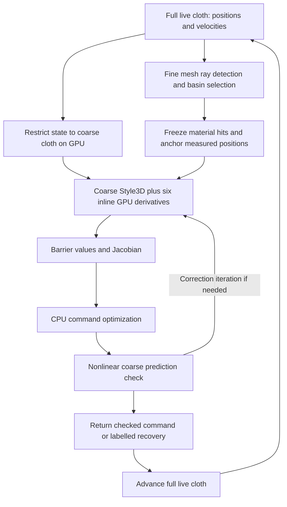

# Cloth CBF development: mathematical formulation, implementation, and results

Prepared 23 October 2026. Scope: the changes discussed in this conversation,
their current implementation, and the evidence available for presenting them.

## 1. Main result and development sequence

The project progressed from repeated perturbed cloth simulations to a
**coarse, differentiable predictive safety filter**. The current method measures
the full cloth, predicts with a smaller physical cloth model, propagates six
command sensitivities alongside the GPU solver, and checks candidate commands
with nonlinear predictions before applying them to the full simulation.

The major changes were:

| Stage | Change | Purpose |
| --- | --- | --- |
| Initial approach | Six additional perturbed trajectories per Jacobian | Estimate how follower velocities change future obstacle clearance |
| Dynamics sensitivity | Analytically differentiate the finite Style3D iterations | Obtain the same six response directions from one nominal trajectory |
| State interface | Expose position and velocity for every particle | Represent ongoing cloth motion explicitly and use a consistent frame snapshot |
| Obstacle geometry | Replace the upper hemisphere with a cube-centered spherical section | Reduce the unnecessarily high top envelope |
| GPU implementation | Propagate derivatives inline in Warp, without checkpoint replay | Remove costly GPU-to-CPU transfers and CPU derivative work |
| Reduced prediction | Use 289 prediction particles for 3,249 live particles | Reduce repeated physics and derivative cost while retaining fine-mesh sensing |
| Validation/documentation | Derivative tests, state-isolation checks, CUDA tests, timings and error measurements | Separate mathematical correctness, numerical accuracy and safety claims |

Ray-selected basins, nominal formation tracking, and optional strain constraints
are surrounding controller mechanisms. Their current behavior is described below
because it determines what the new derivatives actually constrain; they should
not all be presented as inventions of the GPU/coarsening work.

**Accurate research description:** a simulation-based CBF-inspired predictive
filter with forward sensitivities of the finite solver and a coarse physical
prediction model. It is not yet a certified whole-cloth safety controller or a
hard real-time implementation.



## 2. State, inputs, and what “including dynamics” means

For a mesh of N particles, define

$$
q=[q_1^T,\ldots,q_N^T]^T\in\mathbb R^{3N},\qquad
v=[v_1^T,\ldots,v_N^T]^T\in\mathbb R^{3N},\qquad
x=\begin{bmatrix}q\\v\end{bmatrix}.
$$

The controlled input has six components:

$$
u=[v_{F_0,x},v_{F_0,y},v_{F_0,z},v_{F_1,x},v_{F_1,y},v_{F_1,z}]^T.
$$

The two leader velocities are known inputs held fixed during each control
update. Followers and leaders act through prescribed gripper patches, rather
than through six independent forces directly applied to all interior particles.

For free particles, a conceptual mechanical model is

$$
\dot q=v,\qquad
M\dot v=f_{\rm stretch}(q)+f_{\rm bend}(q)+f_{\rm contact}(q,v)+Mg+f_{\rm ext}.
$$

Prescribed boundary motion supplies additional kinematic constraints. In the
implementation, the useful predictive model is the numerical transition

$$
x_{k+1}=\Phi_{\Delta}^{I,L}(x_k,u_k;\ell_k),
$$

where I and L denote the nonlinear and PCG iteration counts. The transition
includes the substeps, pinning, material forces, collisions and velocity update.

The new `ClothState` exposes copied, read-only `(N,3)` position and velocity
arrays, including interior particles. `/fabric/sim/state` now supports
`x,y,z,vx,vy,vz` float32 fields, with a 24-byte point stride. Positions are in
world metres and velocities in metres per second. Position-only Python callers
remain supported and are identified explicitly in diagnostics.

Positions and velocities are **state variables**; the dynamics are the rule
that advances them. Acceleration is normally derived from state, forces and
constraints. Newton's `particle_f` buffer was not exposed as net acceleration:
it is an external-force accumulation buffer, not the sum of Style3D's internal
material and contact effects. See [cloth_state.py](cloth_state.py) and the
[state-interface implementation](../fabric_newton_isaacsim_standalone.py).

### Why measured velocity is helpful but insufficient

For signed obstacle distance d and a static obstacle,

$$
h_i(q)=d(q_i)-r_p-m,\qquad
\dot h_i=\nabla d(q_i)^Tv_i=n_i^Tv_i.
$$

Thus measured velocity reveals whether a particle is approaching the obstacle.
But it does not determine how changing a follower command will alter that
particle's future motion. The controller also needs

$$
\frac{\partial h_i(\Phi_\Delta(x,u))}{\partial u}.
$$

At an unactuated interior particle, the current velocity is fixed when choosing
the new boundary command. A formula using only the instantaneous normal velocity
does not automatically provide a useful input-dependent inequality. Formal
continuous-time approaches must examine input-output relative degree; high-order
CBFs address constraints whose first derivative does not expose the input.
This implementation instead differentiates a finite-time predictor; it does not
implement an HOCBF construction. [Xiao and Belta, 2019](https://arxiv.org/abs/1903.04706)
provide the relevant theoretical distinction.

## 3. What the barrier controller enforces

For a control-affine system, standard CBF theory uses a safe set
`C={x:h(x)>=0}` and conditions such as

$$
L_fh(x)+L_gh(x)u+\alpha(h(x))\ge0.
$$

Under the required regularity, feasibility and feedback assumptions, satisfying
such a condition establishes forward invariance from an initially safe state.
A minimally modifying controller can impose it as an optimization constraint.
This is the theoretical foundation, not a guarantee automatically inherited by
our approximations. [Ames et al., 2017](https://arxiv.org/abs/1609.06408).

Discrete-time barrier conditions constrain a predicted next state. They are
generally nonlinear in the command; they need not form a QP before approximation.
[Agrawal and Sreenath, 2017](https://www.roboticsproceedings.org/rss13/p73.pdf).

### Implemented finite-time target

For a selected material point b and substep time t_s, our code uses

$$
T_{s,b}=\beta_s h_b(x_k)+(1-\beta_s)\eta,
\qquad \beta_s=e^{-a t_s},
$$

with `a=2 s^-1` and `eta=0.0001 m`. This target is the solution of
`dh/dt=-a(h-eta)`, evaluated from the measured current barrier. The nonlinear
prediction is required to satisfy

$$
h_{s,b}(u)\ge T_{s,b}.
$$

For an initially safe selected point and an exact model, a nonnegative target
would preserve nonnegativity at those sampled times. That observation alone
does not establish continuous-time, all-particle invariance.

Define `F_sb(u)=h_sb(u)-T_sb`. At a nominal or trial command u0,

$$
F_{s,b}(u)\approx F_{s,b}(u_0)+J_{s,b}(u-u_0).
$$

The command filter therefore solves the local problem

$$
\min_u\frac12\|u-u_{\rm nom}\|^2,\qquad
J u\ge-F(u_0)+Ju_0,
$$

with a box trust region around u0. The configured displacement change is
0.005 m per axis per iteration, corresponding to 0.3 m/s at a 1/60 s frame.
This bounds the update, not the absolute velocity. `max_speed: 0` disables the
optional absolute follower speed bound. With only linear rows and box bounds the
local mathematical problem is a convex QP; the implementation uses SLSQP. If an
absolute Euclidean speed constraint is enabled, that adds convex quadratic
constraints. Infeasible recovery uses a violation penalty and is labelled unsafe.

The nominal command follows leader velocity and planar formation error; vertical
formation feedback is disabled. Obstacle correction can change all six input
components. Rows are divided by 0.01 m for numerical scaling.

With analytic derivatives, each basin contributes a row at **every substep**.
The legacy finite-difference path instead differentiates the minimum residual
over substeps. Keeping separate rows avoids differentiating a nonsmooth minimum
when its worst substep changes. A nonlinear rollout checks each trial command;
there are at most two correction iterations. See [ray_basins.py](ray_basins.py)
and [solve_filter in core.py](core.py).

### Spatial selection and its limits

The current detector casts 432 rays from the obstacle envelope center through
surface samples, retaining the nearest cloth intersection on each ray. Hits
within the 5 cm clearance margin are grouped using four nearest neighbors with
an 8 cm connection cutoff. Each connected component contributes its lowest
clearance hit. Its triangle and barycentric weights remain fixed throughout a
control update; selection is refreshed next frame.

This is spatial sampling, not a certificate for every mesh element. Multiple
layers along one ray, unsampled folds and other points in a basin can be missed.
Also, the current ray-mode activation is `clearance <= margin`, i.e. `h<=0`;
the separate `activation` setting is not used in this path. Earlier predictive
activation remains a potential improvement, particularly under latency.

If h initially is negative, the decay target can still be negative. Consequently,
even a passing recovery condition need not mean immediate nonpenetration.
`prediction_not_safe` means no checked candidate passed; the best recovery
candidate is still returned, without a safety guarantee.

## 4. From numerical probes to solver sensitivities

Previously, column j was estimated by a forward difference:

$$
J_{:,j}\approx\frac{H(u+\epsilon e_j)-H(u)}{\epsilon},\qquad j=1,\ldots,6,
$$

where H stacks predicted barriers. This needs six additional trajectories once
the baseline is known. These are six input coordinates, not six selected cloth
particles; central-difference verification uses both signs and twelve probes.

The implemented replacement carries

$$
S_q=\partial q/\partial u\in\mathbb R^{3N\times6},\qquad
S_v=\partial v/\partial u\in\mathbb R^{3N\times6}.
$$

Initially both are zero because the measured starting state is held fixed while
varying the new command. Through an update `x_next=Phi(x,u)`, the chain rule is

$$
S_{x,\rm next}=D_x\Phi\,S_x+D_u\Phi.
$$

This is manually implemented forward sensitivity propagation, closely related
to forward-mode algorithmic differentiation. It is not numerical perturbation
or a use of Warp's reverse-mode tape. Six inputs make forward propagation a
natural choice; it is not a proof that forward mode beats reverse mode for every
number of outputs. For differentiation concepts and mode tradeoffs, see
[Baydin et al., 2018](https://jmlr.org/papers/v18/17-468.html).

### Boundary and material derivatives

A follower patch particle obeys `q_pin(t)=q_start+t B_i u+offset`, where B_i
selects that follower's three coordinates. Therefore

$$
S_{q,i}=t B_i,\qquad S_{v,i}=B_i.
$$

Leader derivatives with respect to follower inputs are zero. Every particle
inside a gripper patch receives the prescribed derivative.

For a substep delta_t, the contact-free inertial prediction satisfies

$$
q_I=q_{\rm prev}+\delta t\,v_{\rm prev}+\delta t^2g,
\qquad S_I=S_{q,\rm prev}+\delta t\,S_{v,\rm prev}.
$$

At a nonlinear iterate, the force right-hand side and its derivative are

$$
b=\frac{M}{\delta t^2}(q_I-q)+f_s(q)+f_b(q),
$$
$$
Db=\frac{M}{\delta t^2}(S_I-S_q)
  +\frac{\partial f_s}{\partial q}S_q
  +\frac{\partial f_b}{\partial q}S_q.
$$

Triangle deformation uses the rest inverse matrix:

$$
[F_u\ F_v]=[q_1-q_0\ q_2-q_0]D_m^{-1}.
$$

The installed force formulas use normalized material directions, including the
shear term. Their derivative requires

$$
D(F/\|F\|)=\frac{I-aa^T}{\|F\|}DF,\qquad a=F/\|F\|.
$$

The implementation differentiates those actual formulas rather than substituting
a different cloth energy. Bending contributes the derivative of its installed
linear position force. Warp computes elementwise Jacobian-vector products;
it does not assemble a dense `3N by 3N` force Jacobian. See
[warp_sensitivity.py](warp_sensitivity.py) and the independent sparse reference
[dynamics_sensitivity.py](dynamics_sensitivity.py).

## 5. Why the finite solver itself is differentiated

Projective Dynamics provides an implicit simulation framework using efficient
structured iterations. It motivates this solver family, but the specific
Style3D implementation and its force formulas remain the source of truth here.
[Bouaziz et al., 2014](https://www.projectivedynamics.org/projectivedynamics.pdf).

If an exact implicit solution satisfies `R(q,u)=0`, the implicit function theorem
would give

$$
R_q S_q=-R_u
$$

when the required derivative and invertibility conditions hold. However, the
executed simulator stops after finite nonlinear and linear iterations. Its
output is `q^(I,L)(u)`, not necessarily the root of R. Differentiating the root
can therefore give a different answer from differentiating the executed map.

An earlier small stiff-cloth experiment recorded approximately 36% relative
disagreement for a converged-equation derivative even with 30 nonlinear
iterations. This is an implementation diagnostic, not a universal criticism of
implicit differentiation. We consequently differentiate the actual truncated
iteration sequence. DiffPD is relevant related work in differentiable implicit
simulation, but its adjoint/prefactorization approach is not the algorithm
implemented here. [Du et al., 2022](https://diffpd.csail.mit.edu/).

### Differentiating preconditioned conjugate gradients

Let A be the contact-free PD matrix, P the preconditioner, y the position
increment, r the residual, z the preconditioned residual, and p the search
direction. A and P are independent of the current command in this supported
contact-free path. Thus

$$
Dr=Db-A\,Dy,\qquad Dz=P^{-1}Dr,\qquad D(Ap)=A\,Dp.
$$

The PCG scalar coefficients still depend on the command. With
`nu=r^T z`, `mu=p^T A p`, and `alpha=nu/mu`,

$$
D\nu=z^TDr+r^TDz,\qquad
D\mu=(Ap)^TDp+p^TA\,Dp,
$$
$$
D\alpha=\frac{D\nu-\alpha D\mu}{\mu}.
$$

For `beta=nu/nu_old`,

$$
D\beta=\frac{D\nu-\beta D\nu_{\rm old}}{\nu_{\rm old}},\qquad
Dp=Dz+\beta Dp_{\rm old}+p_{\rm old}D\beta.
$$

Finally,

$$
Dy\leftarrow Dy+\alpha Dp+pD\alpha,
\qquad
Dr\leftarrow Dr-\alpha A Dp-(Ap)D\alpha.
$$

All D quantities carry six directions. Ignoring `Dalpha` or `Dbeta` would
differentiate a different finite iteration. The first nonlinear solve starts
with the same `delta_t*v` increment as upstream; later solves start from zero.
Primal denominator guards are mirrored in the derivative kernels.

After each substep, the installed velocity update is

$$
v_{\rm next}=0.998\frac{q_{\rm next}-q_{\rm prev}}{\delta t},\qquad
S_{v,\rm next}=0.998\frac{S_{q,\rm next}-S_{q,\rm prev}}{\delta t}.
$$

Pin velocities are then prescribed exactly. These are derivatives of the
implemented arithmetic, locally within its branches; rounding, contact switches
and geometric ties prevent a blanket claim of everywhere-smooth exactness.

## 6. GPU changes and the source of the stall

The initial analytic implementation recorded primal solver buffers on the GPU,
transferred them to the CPU, and replayed derivatives in NumPy/SciPy. At the
default settings there are `8*10*16=1,280` PCG iterations per prediction. Four
recorded vec3 arrays require approximately

$$
4\times12\times N\times8\times10\times16\ \text{bytes},
$$

about 190 MiB at N=3,249, before other tape data. Many allocations, readbacks,
synchronizations and CPU replay blocked the main thread that also services the UI.

The final GPU backend adds repository subclasses `TangentStyle3D` and
`TangentPcg`. They run the original primal stages and derivative kernels together,
using reusable device buffers and native device reductions. The derivative
workspace scales with six directions times particle count rather than with the
stored iteration history. Full-resolution buffers plus observations were about
3.2 MiB with strain disabled. There is no per-iteration checkpoint replay or
host readback; CUDA graph capture is supported.

Warp provides compiled CUDA kernels and geometry primitives; the custom tangent
equations are our implementation. [NVIDIA Warp](https://developer.nvidia.com/warp-python).

Only observation Jacobians and small flags are extracted for CPU command
optimization. Basin grouping and optimization are still CPU operations, and
full-state diagnostics still involve readback. Therefore “GPU backend” refers
to prediction dynamics and derivatives, not the entire CBF pipeline. The CPU
reference remains available with preallocated, batched recordings. UI events are
also serviced between expensive rollouts.

The installed Isaac/Newton source files were not modified: the extensions are
local subclasses. They depend on private Style3D interfaces and must be retested
after upstream changes. The previous audit used Newton 1.2.1 and Warp 1.13.0.

### Rollout counts

| Situation | Fresh finite differences | Inline tangent |
| --- | ---: | ---: |
| No active hit | 0 | 0 |
| Nominal command passes | 1 | 1 |
| One correction | 8 | 2 |
| Two corrections | 15 | 3 |

“One nominal trajectory for a Jacobian” does not mean one trajectory for every
complete control update: corrected commands still need nonlinear checks.

Contact derivatives are not implemented. Active contact, degenerate material
directions or unusable derivatives trigger finite-difference fallback. Physical
collisions remain enabled. Fallback can still be expensive.

## 7. Reduced prediction with full-resolution sensing

The final launch default requests 14 base cells per material axis. Additional
gripper-boundary lines produce 16-by-16 coarse cells: **289 particles and 512
triangles**, versus **3,249 particles and 6,272 triangles** for live physics.

This is a coarser physical discretization, not a learned model, a POD basis, or
six independently simulated particles. All coarse particles remain dynamically
coupled. Both nonlinear predictions and derivatives use the coarse model.

Let R select retained fine vertices, including XYZ blocks. At every frame,

$$
q^c_0=Rq^f_0,\qquad v^c_0=Rv^f_0.
$$

GPU gather kernels perform this restriction. The coarse model is restarted
from the current measurement each frame, avoiding accumulated independent drift.
Uniform material constants, total mass, rest dimensions, gravity, obstacle
properties and physical gripper dimensions are preserved. Specifically,

$$
\rho_A=\frac{\sum_i m_i^f}{A_{\rm rest}},\qquad
m_j^c=\rho_A\sum_{T\ni j}\frac{A_T}{3}.
$$

Equal total mass does not make the two discretizations dynamically identical.

### Fine geometry plus coarse displacement

For a selected fine material hit `p_b^f(0)`, let W_b be its barycentric
interpolation operator on the coarse mesh. Compute the fixed frame residual

$$
e_b=p_b^f(0)-W_bq^c_0.
$$

Then use

$$
\hat p_b(t,u)=W_bq^c(t,u)+e_b
             =p_b^f(0)+W_b[q^c(t,u)-q^c_0].
$$

The starting position and clearance exactly match the fine measurement. The
geometry residual is refreshed each frame and is constant with respect to the
new command, so

$$
\frac{\partial\hat p_b}{\partial u}=W_bS_q^c,\qquad
J_{h_b}=n(\hat p_b)^TW_bS_q^c.
$$

Distances and derivatives both use the offset-corrected point. Fine wrinkles are
therefore retained in current sensing, while their subsequent motion is
approximated by coarse displacement. Fine velocities between sampled nodes are
not independently evolved. A tested ballistic residual-velocity variant increased
worst position error and was not retained.

The mapping uses rest/material coordinates, not nearest deformed XYZ, so folded
layers cannot arbitrarily exchange correspondences. Details are in
[coarse_prediction.py](coarse_prediction.py) and [COARSE_PREDICTION.md](COARSE_PREDICTION.md).

Supported construction is currently one initially flat rectangular XY cloth
with uniform material/density, four corner patches, and static plane/box
obstacles. Coarse mode requires ray basins and disabled strain constraints.
`prediction_grid_cells: 0` restores full-resolution prediction.

## 8. Obstacle envelope and material policy changes

For cube half-extents `(a,b,c)`, the old upper cap was a hemisphere of radius
`r=sqrt(a^2+b^2)` centered at the top-face center. Its peak was r above the top.

The new upper section is centered exactly at the cube center with

$$
R=\sqrt{a^2+b^2+c^2}.
$$

Only the part above the top-face plane is used. It meets the cylinder at
`(rho,z)=(r,c)` in cube-centered coordinates. The lower hemisphere remains.
The radius is the smallest one with that center that contains all top corners.

For `(a,b,c)=(0.22,0.22,0.16)` m,

$$
r\approx0.3111\text{ m},\quad R\approx0.3499\text{ m},\quad
\text{new top gap}=R-c\approx0.1899\text{ m}.
$$

Thus the envelope's top gap decreased from **31.1 cm to 19.0 cm**. The sphere
radius increased while its center moved downward. Increasing R further with its
center fixed would increase the gap. The separate 5 cm CBF margin and 8 mm
particle radius were not reduced. The peak desired particle-center height is
still approximately `19.0+5.0+0.8=24.8 cm` above the cube top.

CPU geometry, GPU distances/normals, atlas points and wireframe now agree on
this composite surface. It has a crease at the top/side junction, so derivatives
are local away from nearest-point ties. This changed the barrier geometry, not
the physical cube collider. See [core.py](core.py) and [newton_runtime.py](newton_runtime.py).

Optional material policies use the triangle deformation columns to define

$$
h_u=\epsilon_u-(\|F_u\|-1),\quad
h_v=\epsilon_v-(\|F_v\|-1),\quad
h_{\pm}=\gamma\mp\frac{F_u^TF_v}{\|F_u\|\|F_v\|}.
$$

They limit extension and normalized shear; they are not a calibrated tearing
model. They remain disabled in the default ray/coarse mode. Disabling these
controller constraints does not disable cloth stretching or bending forces.

The earlier installed-source audit found that anisotropic stretch and bending
settings affect this Style3D path, while `tri_ka`, `tri_kd`, `edge_kd`, and the
legacy soft-contact-radius assignment do not affect it in the presumed way.
Velocity damping uses the explicit 0.998 factor. These are version-specific
findings recorded in [material_audit.py](material_audit.py), not universal claims
about every Newton solver.

## 9. Evidence: speed, numerical accuracy, and what was not established

### Previously recorded host-GPU results

Hardware: RTX 5070 Laptop GPU, 8 GiB. Full live cloth: 3,249 particles, eight
substeps, ten nonlinear iterations and sixteen PCG iterations. Comparisons used
the centered top envelope, a 0.55 m starting height, and active recovery.

| Derivative/prediction path | Frames | Median control + live physics |
| --- | ---: | ---: |
| GPU primal, CPU reference derivative replay | 3 | 5,039 ms |
| Full-resolution inline GPU derivatives | 5 | 280 ms |
| Coarse inline GPU derivatives | 5 | 178 ms |

The inline full-resolution path was about 18 times faster than CPU replay.
Coarsening removed about 36% of the remaining total time, or a further 1.57-fold
speedup. The combined recorded ratio is about 28 times, but these are short
sequential benchmarks rather than a broad statistical performance study.

These measurements exclude rendering, ROS, initial compilation and an independent
benchmark audit prediction. They imply about 5.6 control updates per wall-clock
second for the coarse active case, not 60 FPS. Coarsening does not remove kernel
launches, sequential solver iterations, GPU reductions or full live physics.
The configured simulation timestep remains 1/60 s; it is not the measured
wall-clock control period.

The GPU `sensitivity_ms` field is extraction time because derivative work occurs
inside the rollout. It must not be presented as total derivative cost. During
finite-difference fallback, timing fields can overlap; total controller time is
the useful comparison.

### Numerical checks

Previously executed checks reported **57 passing tests**, including actual CUDA
graph execution, mass/obstacle preservation, state transfer, pin derivatives,
CPU-reference agreement, repeated-command resets, live-state isolation and
equivalence when coarse resolution equals fine resolution. Smaller full-mesh
derivative tests gave relative norm errors around 0.065% against central
differences, including strain.

For the coarse five-frame benchmark:

| Quantity | Recorded value | Meaning |
| --- | ---: | --- |
| Maximum position error anywhere on the lifted fine cloth | 6.94 mm | Approximation relative to one fine live step |
| Position RMS error per frame | 0.41–0.51 mm | Average spatial prediction discrepancy |
| Maximum selected-hit endpoint barrier error | 0.071 mm | Only selected points at the final substep |
| Maximum coarse Jacobian central-difference discrepancy | 1.55e-5 s | Derivative implementation accuracy, not fine-model agreement |
| Held-out coarse barrier linearization error | 2.04e-7 m | Local first-order approximation within the coarse model |

The velocity-residual experiment increased worst position error to about
16.85 mm and was reverted. The current implementation uses fixed position
residuals plus sampled coarse velocities.

All five recovery frames in the reported coarse run remained
`prediction_not_safe`; the initial state was already inside the clearance
margin. These experiments establish useful numerical and performance properties,
not successful safety recovery. Interactive Isaac/ROS rendering was not rerun
for the final GPU/coarse changes.

**Provenance:** values above come from the earlier runs in this conversation and
the retained implementation guides. At preparation of this report, the raw
`/tmp/capsule-*-gpu-56.json` files and the external Isaac installation were no
longer available in the current tool environment. Results were not rerun or
independently reverified here. Permanent benchmark artifacts should be saved
before using these measurements as publication evidence.

## 10. Remaining research questions

1. **Bound model error.** A coarse Jacobian can be correct for the coarse model
   while predicting the fine cloth imperfectly. Mesh-resolution sweeps and
   multiple deformation/contact scenarios are needed.
2. **Broaden safety coverage.** Selected rays/basins do not cover every triangle
   or multiple cloth layers, and checks at substeps do not establish safety
   between substeps. Earlier activation deserves evaluation.
3. **Handle contact sensitivity.** Contact currently causes finite-difference
   fallback. Its nonsmooth mode changes require deliberate treatment.
4. **Reduce remaining latency.** Profile kernel/reduction overhead, avoid
   derivative work on final checks that cannot be relinearized, and study
   different predictor iteration budgets. These are proposals, not delivered
   changes. Actual deployment would also need bounded actuator commands and
   latency-aware control.
5. **Demonstrate avoidance from initially safe states.** Measure minimum
   clearance, violations, recovery failures, tracking error and timing across
   repeatable leader trajectories rather than relying on unsafe-start tests.

One possible robust extension follows directly from a position-error bound. If
`||p_true-p_pred||<=epsilon`, signed-distance Lipschitz continuity implies

$$
h_{\rm true}\ge h_{\rm predicted}-\varepsilon.
$$

Enforcing `h_predicted >= T + epsilon` would then account for that pointwise
model error, provided epsilon is a valid bound for the relevant times and
commands. The measured 0.071 mm sample error is not such a bound, and this robust
constraint is not currently implemented.

## 11. Reproduce and present

Normal launch from the repository root:

```bash
python3 capsule_cbf/launch_capsule_sim.py
```

Current key settings:

```json
"sensitivity_method": "solver_tangent",
"sensitivity_backend": "warp",
"prediction_grid_cells": 14,
"top_cap_mode": "centered_sphere",
"ray_basins_enabled": true,
"strain_enabled": false
```

The host Isaac Python test and benchmark commands, including PYTHONPATH, are
documented in [GPU_SENSITIVITY.md](GPU_SENSITIVITY.md) and
[COARSE_PREDICTION.md](COARSE_PREDICTION.md). Use resolution 0 for full prediction;
use backend `cpu` for the reference replay; use method `finite_difference` for
the old perturbation approach.

A useful presentation sequence is: problem and state; barrier objective;
six-probe cost; finite-solver tangent; GPU execution; coarse-to-fine mapping;
geometry correction; measured performance and accuracy; limitations and next
experiments. A defensible closing statement is:

> We implemented a coarse GPU predictive cloth filter with analytic derivatives
> of the executed solver. It substantially reduces computation and preserves
> measured fine-mesh clearance at the start of each prediction. Numerical checks
> support derivative correctness and quantify short-horizon approximation error;
> whole-cloth safety and real-time operation remain open validation goals.

## Primary references and their roles

1. Ames, A. D., Xu, X., Grizzle, J. W., and Tabuada, P. (2017).
   [Control Barrier Function Based Quadratic Programs for Safety Critical Systems](https://arxiv.org/abs/1609.06408).
   IEEE Transactions on Automatic Control, 62(8), 3861–3876.
   DOI: 10.1109/TAC.2016.2638961. Foundation for CBF invariance and optimization.
2. Agrawal, A., and Sreenath, K. (2017).
   [Discrete Control Barrier Functions for Safety-Critical Control of Discrete Systems with Application to Bipedal Robot Navigation](https://www.roboticsproceedings.org/rss13/p73.html).
   Robotics: Science and Systems XIII. Discrete-time barrier theory; our chosen
   decay target and local linearization are implementation-specific.
3. Xiao, W., and Belta, C. (2019).
   [Control Barrier Functions for Systems with High Relative Degree](https://arxiv.org/abs/1903.04706).
   Context for why instantaneous position barriers need careful input-relative-degree treatment.
4. Bouaziz, S., Martin, S., Liu, T., Kavan, L., and Pauly, M. (2014).
   [Projective Dynamics: Fusing Constraint Projections for Fast Simulation](https://www.projectivedynamics.org/projectivedynamics.pdf).
   ACM Transactions on Graphics, 33(4), Article 154. DOI: 10.1145/2601097.2601116.
   Background for the solver family, not a substitute for auditing Style3D.
5. Baydin, A. G., Pearlmutter, B. A., Radul, A. A., and Siskind, J. M. (2018).
   [Automatic Differentiation in Machine Learning: a Survey](https://jmlr.org/papers/v18/17-468.html).
   JMLR, 18(153), 1–43. Chain-rule propagation and differentiation modes.
6. Du, T., Wu, K., Ma, P., Wah, S., Spielberg, A., Rus, D., and Matusik, W. (2022).
   [DiffPD: Differentiable Projective Dynamics](https://diffpd.csail.mit.edu/).
   ACM Transactions on Graphics, 41(2). DOI: 10.1145/3490168.
   Related differentiable implicit simulation; not an implementation attribution.
7. NVIDIA. [Warp framework documentation and overview](https://developer.nvidia.com/warp-python).
   Primary source for the GPU programming framework.

Repository code and tests are the primary sources for our implementation and
measurements. The cited papers establish theory and related work; they do not
verify this code, its measured speedups, or its safety guarantees.
