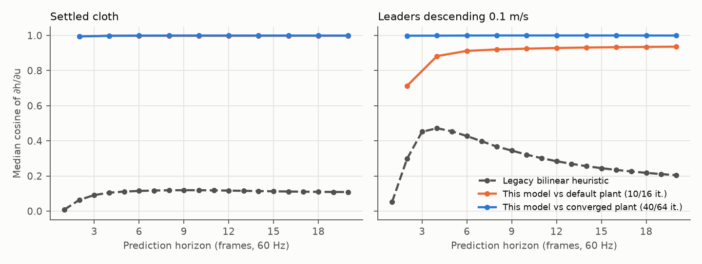
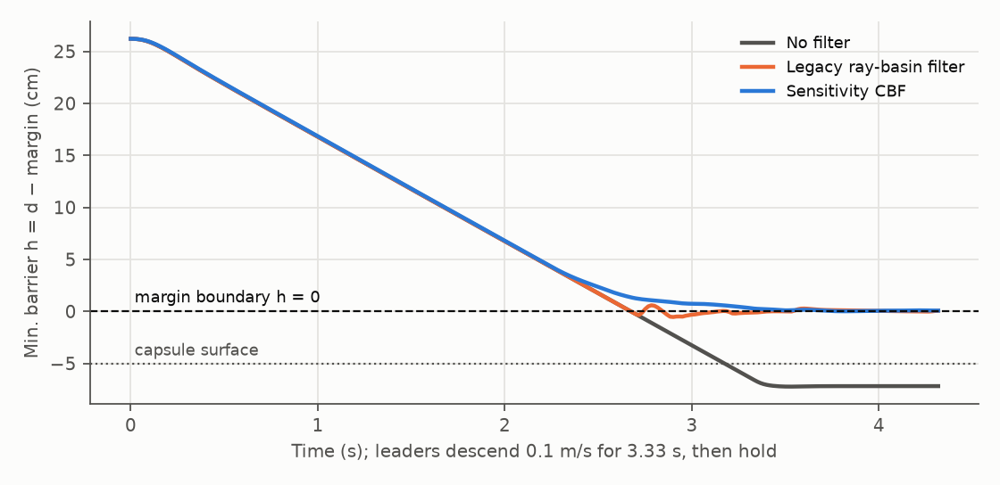
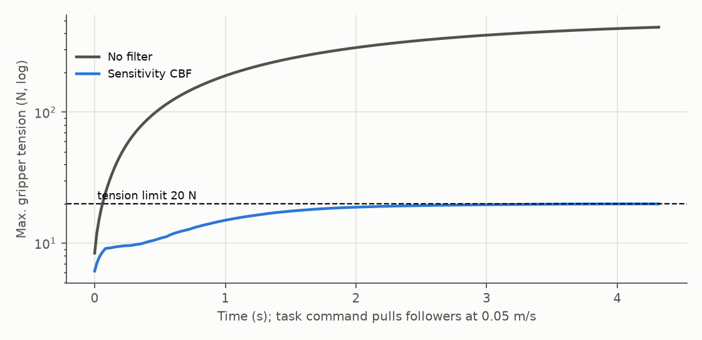
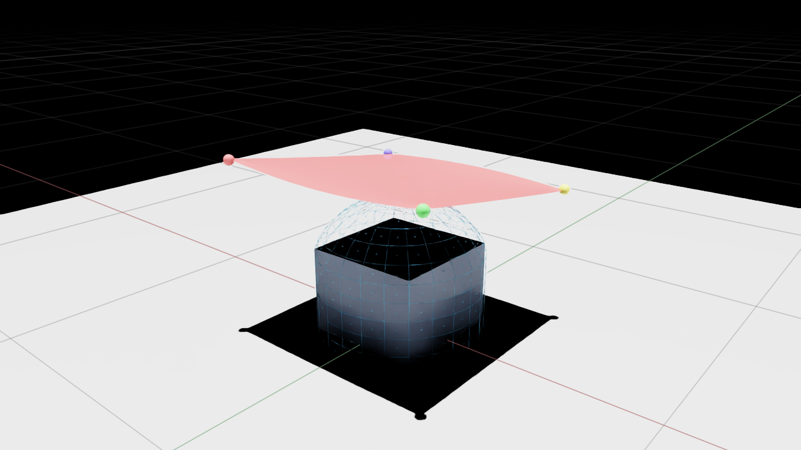

# Real-time sensitivity CBF for collaborative cloth manipulation

Report on the redesign of the capsule control-barrier filter (October 2026).
Every step lists what changed, the formulation, why that method was chosen
over the alternatives, the validation performed and its result. Numbers come
from runs made for this report on the RTX 5070 Laptop GPU (plant) and the host
CPU (controller); reproduction commands are in Section 12.

## 0. Summary

The previous filter ran the full nonlinear Newton cloth simulator inside the
control loop (2-3 rollouts plus a derivative through 1,280 unconverged PCG
iterations per active frame, ~178 ms), switched its barrier on only after the
cloth had already entered the safety margin, looked one frame ahead, and had no
stretch protection in its default configuration. The redesigned filter (now the only controller in this repository):

| | Legacy ray-basin filter | Sensitivity CBF (this work) |
|---|---|---|
| Model in the loop | Nonlinear Newton rollouts (2-15 per frame) | One linearization of a 17x17 cloth, exact command sensitivities |
| Look-ahead | 1 frame (16.7 ms) | 20 frames (0.33 s) + terminal look-ahead |
| Barrier activation | Only when h <= 0 now (inside the margin) | When h is *predicted* to reach 0 within 0.33 s |
| Stretch protection | Disabled by default | Gripper tension + KS fabric strain, priority over clearance |
| Robust margin | Fixed 0.1 mm | Online conformal quantile of measured residuals + leader bound |
| Command smoothness | Unbounded jumps | Speed and acceleration box |
| Controller time per frame | ~178 ms (p50, coarse) | 12.5-13.1 ms p50, <= 16.4 ms p95, <= 20.8 ms max (CPU) |

Closed-loop results on the headless 56x56 Newton plant are in Section 10.

## 1. Starting point and diagnosis

The critique preceding this work identified, in order of impact:

1. **Activation inside the unsafe set.** Ray mode kept a hit only if
   `d <= margin`, so every barrier started with `h <= 0`; the condition
   `h(x_{k+1}) >= e^{-a dt} h(x_k)` then only *recovered* from violations and never
   prevented them, and constraints appeared and disappeared at `h = 0`
   (command discontinuities, chattering).
2. **One-frame horizon on an inertial, under-actuated system.** From follower
   velocity to the position of a cloth point several mesh hops away the
   continuous-time relative degree is about `2k+1`; a single-step discrete CBF
   (Agrawal and Sreenath, 2017) cannot guarantee next-frame feasibility.
3. **A non-smooth, discontinuous barrier** (ray hits, basin membership, argmin
   representative), outside the regularity assumed by CBF invariance results
   (Ames et al., 2017; Glotfelter et al., 2017).
4. **Model error larger than the tightening** (0.1 mm vs up to 6.9 mm).
5. **Leader treated as a known constant.**
6. **Computation:** nonlinear simulator in the loop, derivative of a truncated
   solver, Python orchestration, synchronous with rendering.

## 2. Step 0: validation environment and baseline

**Change.** None to the controller. The Isaac installation referenced by the
docs (`/media/taha/ExtermeLinux/isaacsim`) was not mounted, and the local
`newton_env` (Newton 1.0.0) crashed in every Newton-dependent test. The cause:
Newton 1.0.0 requires an explicit `SolverStyle3D._precompute(builder)`; without
it the projective-dynamics matrix is uninitialized and the PCG kernel
segfaults. The repository targets Newton 1.2.1 (precompute in `__init__`), the
version bundled with Isaac. All validation therefore used an isolated
environment with `newton==1.2.1`, `warp-lang==1.13.0`.

**Validation.** All 57 pre-existing tests pass there (38 NumPy, 19 Newton).

The Isaac installation was mounted later; Section 10.5 reports the Kit/ROS runs.

## 3. Step 1: physical parameters

**Problem.** Style3D's `add_cloth_grid` converts `mass` (per particle) into a
uniform areal density `rho = m (n_x+1)(n_y+1) / A`. With 0.003 kg per particle,
3,249 particles and 0.84 x 0.84 m, `rho = 13.8 kg/m^2` (9.7 kg of cloth). Woven
fabrics are about 0.1-0.4 kg/m^2 (mass per unit area measured per ASTM D3776;
shirting ~0.1-0.15, denim ~0.3-0.45).

**Change.** New setting `areal_density` (default 0.2 kg/m^2); the Isaac entry
derives `mass_per_particle = rho A / ((n_x+1)(n_y+1))` = 4.34e-5 kg.

**Validation** (settled cloth after 2 s, same plant, `capsule_cbf/scenario.py`):

| Areal density | Total mass | Max gripper tension | Max tensile strain | Max shear cosine | Sag |
|---|---|---|---|---|---|
| 13.8 kg/m^2 (old) | 9.75 kg | **99.3 N** | **5.28 %** | 0.158 | 9.5 cm |
| 1.0 kg/m^2 | 0.71 kg | 14.6 N | 0.78 % | 0.025 | 3.6 cm |
| 0.2 kg/m^2 (new) | 0.14 kg | 4.8 N | 0.26 % | 0.008 | 2.0 cm |

With the old mass, the cloth at rest already violates a 2 % strain or 20 N
limit, so no stretch-protecting controller could be feasible. Section 10.4
shows the closed-loop consequence.

**Not changed, and why.** The stretch stiffness (3e4 N/m) and the 2 % / 20 N
limits remain uncalibrated policy values. Calibration requires tensile/shear
tests of the actual fabric (KES-F, Kawabata 1980; ASTM D5034/D5035) or
data-driven estimation (Wang et al., 2011; Miguel et al., 2012).

## 4. Step 2: Style3D-consistent mechanics (`cloth_model.py`)

**Formulation.** For triangle t with rest inverse `D_m^{-1}` (Newton's
`tri_poses`), `F = [x_1-x_0, x_2-x_0] D_m^{-1} = [f_u f_v]`,
`l_u = |f_u|`, `u = f_u/l_u`, `c = u.v`. The installed Style3D stretch force on
corner i is (Baraff and Witkin, 1998, as implemented by Newton)

```
f_i = -A_t [ k_u (l_u-1) a_i u + k_v (l_v-1) b_i v + k_s c (b_i u + a_i v) ]
```

with `a_i, b_i` the columns of `[-(D^-1)_0-(D^-1)_1; D^-1]`. Bending is the
quadratic isometric model `f_bend = -Q q` with constant PSD `Q = sum_e w_e w_e^T`
(cotangent weights scaled by `sqrt(3 k_e / A_e)`, Newton 1.6's `eval_bend_kernel`;
Newton 1.2.1 used the scale `k_e / A_e`, see Section 10.6). The exact Jacobian `J = df/dq` reuses the repository's
previously verified element derivative (`stretch_force_blocks`).

**Stiffness projection.** `K = -J` is indefinite under compression (negative
geometric stiffness) and slightly non-symmetric (Style3D's shear force uses
normalized directions, so it is not an exact energy gradient). For the implicit
solve each 9x9 element block is symmetrized and its negative eigenvalues are
clamped to zero (Teran et al., 2005) - the standard way to obtain an SPD
system for implicit cloth/FEM steps.

**Validation** (`tests/test_cloth_model.py`):

| Check | Result |
|---|---|
| NumPy forces vs Newton's installed `eval_stretch_kernel`+`eval_bend_kernel` (random deformation) | equal within 2e-5 relative |
| Stiffness vs central differences of forces | within 1e-4 relative |
| Projected stiffness symmetric PSD on a compressed mesh | min eigenvalue >= -1e-8 relative |
| Gripper resultant equals summed node forces; its Jacobian vs differences | pass |
| KS strain bound `max g <= KS <= max g + ln(4T)/kappa` and its gradient | pass |

## 5. Step 3: reduced linear horizon model (`cloth_model.py`, `reduced_cloth.py`)

### 5.1 Formulation

Free DOFs `q_f`, prescribed gripper DOFs `p(t) = p_0 + t V_c` (exactly as the
plant prescribes its pinned patches). One linearization at the measured state
`q_0`, step `h`:

```
(M + h^2 K_ff) v+ = M v + h [ f(q_0) - K_ff (q_f - q_f0) - K_fp (p(t+h) - p_0) + M g + b ]
q_f+ = q_f + h v+,      v+ <- 0.998^{h/h_plant} v+     (the plant's velocity damping)
```

Sensitivities to the 12 corner-velocity components (columns 0-5 followers,
6-11 leaders) obey the same factorized matrix (forward sensitivity analysis,
cf. Serban and Hindmarsh, 2005):

```
(M + h^2 K_ff) S_v+ = M S_v - h (K_ff S_q + K_fp Pi(t+h)),   Pi(t) = t D,   S_q+ = S_q + h S_v+.
```

`S_q(t_k)` is exactly "which follower command moves which cloth point, in which
direction, after how long". `b` is a force bias from the disturbance observer
(Section 7.3).

**Coarse model with fine sensing.** Dynamics run on a material-coordinate
subset of the fine grid (`MaterialGrid`, 17x17 nodes incl. gripper boundary
lines, density preserved). A fine material point i is predicted as
`p_i(t) = p_i(0) + W_i [q_c(t) - q_c(0)]` (anchored at its measured fine
position), with `dp_i/du = W_i S_q`.

### 5.2 Why this model (alternatives considered)

| Option | Verdict |
|---|---|
| Nonlinear Newton rollouts + derivative through truncated PD/PCG (legacy) | 2-15 full simulations per frame; derivative of numerical truncation, 6x primal cost |
| Finite differences of rollouts | 7+ rollouts per linearization |
| Nonlinear forces with per-step exact Jacobian ("trajectory" mode, implemented) | Exact derivative of the scheme, but **diverges** once compressed triangles appear (Section 5.3) |
| Frozen exact Jacobian with nonlinear forces ("frozen" mode, implemented) | Same instability; > 10 % wrong for slack cloth |
| Modal / POD reduction (Pentland and Williams 1989; James and Pai 2002) | Needs eigen-decomposition per state change; pin-driven quasi-static response needs static correction |
| Learned / identified linear model (Luque et al., 2024) | Data-hungry, re-identification per material |
| **Affine model with projected K (chosen)** | Linear SPD system: implicit Euler unconditionally stable; derivative exact for the model; one factorization per frame |

The approach is the implicit-function-theorem route used by DiffPD (Du et al.,
2022): differentiate the solved implicit system, not the iterations of its
solver.

### 5.3 Validation against the nonlinear plant (`validate_sensitivity.py`)

Reference: central differences (+-0.01 m/s) of full 56x56 Newton rollouts over
the whole 20-frame horizon, for each of the six follower components, at a
settled state and while leaders descend at 0.1 m/s. Metric: median (over the 64
cloth points closest to the capsule) cosine and relative error of the
clearance gradient `dh/du = n^T dp/du`, and drift position error.

| Model, plant | State | dh/du cosine, first output / frame 6 / 10 / 20 | Rel. error, frames 6 / 10 / 20 | Drift error |
|---|---|---|---|---|
| Legacy bilinear heuristic | settled | 0.01 / 0.12 / 0.12 / 0.11 | 1.0 / 1.0 / 0.99 | - |
| Affine coarse, default plant (10 PD / 16 PCG) | settled | 0.99 / 1.00 / 1.00 / 1.00 | 3.4 / 1.6 / 0.72 | 0.6-1.0 mm |
| Affine coarse, default plant | descending | 0.71 / 0.91 / 0.93 / 0.94 | 7.2 / 3.1 / 0.74 | 8-24 mm |
| Affine coarse, converged plant (40 PD / 64 PCG) | settled | 1.00 / 1.00 / 1.00 / 1.00 | 0.09 / 0.25 / 0.36 | 0.7-0.9 mm |
| Affine coarse, converged plant | descending | 1.00 / 1.00 / 1.00 / 1.00 | 0.04 / 0.20 / 0.26 | 1.0-1.1 mm |
| Trajectory (nonlinear) mode | descending | diverges (errors > 1e30) | - | - |

Gripper-tension sensitivity `dT/du` (same states, 4 grippers, median over grippers):

| Plant | State | dT/du cosine, first output / 6 / 10 / 20 | Norm ratio model/plant |
|---|---|---|---|
| Default (10/16) | settled | 0.96 / 0.92 / 0.94 / 0.95 | 0.70 / 0.72 / 0.88 / 1.02 |
| Default (10/16) | descending | 0.98 / 0.99 / 1.00 / 0.99 | 0.45 / 0.54 / 0.62 / 0.71 |
| Converged (40/64) | settled | 0.98 / 0.98 / 0.98 / 0.96 | 0.81 / 0.96 / 0.95 / 0.98 |
| Converged (40/64) | descending | 0.98 / 0.98 / 0.98 / 0.97 | 0.81 / 0.97 / 0.94 / 0.97 |



Findings:

- **The legacy heuristic is the reason for rough commands.** Its assumed
  influence `dp_i/du_c = t w_ic I` is essentially uncorrelated with the real
  response (cosine 0.01-0.12).
- **Against a converged plant the model is accurate** in direction (median
  cosine >= 0.995) and magnitude (4-36 % beyond the first output) with ~1 mm drift.
  The 17x17, 33x33 and full 57x57 models give nearly identical results, so the
  coarse grid is not the limiting error.
- **The default plant is not converged.** With 10 PD x 16 Jacobi-PCG
  iterations, boundary motion propagates only a bounded number of nodes per
  substep; the plant lags the physics it discretizes (drift error 8-24 mm when
  the model is compared with it, 1 mm against the converged plant). Real cloth
  responds like the converged plant. Recommendation: raise plant iterations
  or use a better preconditioner; the controller's robust margin absorbs the
  difference meanwhile.
- **Slack cloth is the model's blind spot.** A model linearized at an
  untensioned sheet has no out-of-plane stiffness and predicts free fall; real
  cloth stiffens as it sags. The error is conservative (false clearance
  alarms). The Isaac entry therefore skips the filter for `warmup_frames`
  (1.5 s) while the spawned flat sheet settles.

### 5.4 Real-time engineering

| Measure | Effect |
|---|---|
| Coarse 17x17 dynamics (819 free DOF) | accuracy unchanged vs fine (Section 5.3) |
| Fixed-topology slots: element blocks -> `K_ff`, `K_fp`, band storage by one `bincount` | no sparse-matrix construction per frame |
| Reverse Cuthill-McKee ordering (Cuthill and McKee, 1969), banded Cholesky (LAPACK `pbtrf`) | factorization 6 ms -> 1 ms |
| Output stride 2 (10 outputs over 20 frames), 13 RHS per solve | prediction 10 -> 5 ms, same accuracy |
| `OPENBLAS_NUM_THREADS=1` | linearization p95 140 ms -> ~4 ms (thread hand-off stalls on tiny LAPACK calls) |
| Batched KS strain over horizon outputs | 8 ms -> <1 ms |

## 6. Step 4: barrier outputs and multi-step discrete CBF (`sensitivity_cbf.py`)

### 6.1 Outputs

1. **Capsule clearance** `h_i = d_capsule(p_i) - r_p - m` (capsule kept as the
   obstacle envelope; since November 2026 its top cap is a sphere of twice the
   box half-diagonal, 0.70 m, through the four top corners: 7.3 cm above the
   table instead of 19 cm, `top_cap_radius_scale`; the results in Section 10
   were obtained with the box-centered cap, scale 1). Candidate points are strict local minima, over a
   3-ring neighborhood of the **rest-mesh graph**, of the *predicted*
   `min(h_i(0), h_i(t_N/2), h_i(t_N))`, kept when `<= prediction_activation`
   (0). A constraint therefore exists 0.33 s before the cloth would reach the
   margin, which fixes diagnosis 1 through the horizon rather than a spatial
   band. An additional 12 cm spatial band was the first design; Section 10.3
   shows it over-reacts and destabilizes the stretch trade-off.
   Rest-mesh adjacency does not merge layers of a fold, unlike world-space
   nearest neighbors; every fine vertex is a candidate (no 7-11 cm ray gaps).
2. **Gripper tension** `T_c = |sum_{j in P_c} f_j(q)|`, the cloth's pull on
   gripper c - what a wrist force/torque sensor measures on a real robot.
3. **Gripper-band strain** `KS_c = (1/kappa) ln sum_t,m exp(kappa g_tm)` with
   `g = (eps_weft/lim, eps_warp/lim, +-shear/lim)` over unpinned triangles
   within 6 cm of patch c. KS (Kreisselmeier and Steinhauser, 1979) is the
   standard smooth, conservative aggregate of stress constraints (Le et al.,
   2010): `max g <= KS <= max g + ln(n)/kappa`.

### 6.2 Prediction of each output

- Clearance uses the full prediction (positions do not amplify error).
- **Stretch outputs use only the input-driven response**
  `y_k(u, w) = y_now + (dy/dq) S_k [u; w]`. First implementation predicted them
  from drifted coarse positions: a 1 mm drift error over a 5 cm coarse element
  is 2 % strain, the size of the limit, so rows were 2.5-12x the limit off and
  the QP was infeasible every frame. Stretch is quasi-static and driven by the
  relative gripper motion, which `S_k` captures; free swing is left to the
  conformal bound.
- The tension sensitivity was validated against the plant like clearance
  (Section 5.3): direction cosine 0.92-0.995, magnitude ratio model/plant
  0.45-1.02 (default plant) and 0.81-0.98 (converged plant).
- **Rejected variant (negative result).** `y_k` reuses the current gripper
  velocity as a step input every frame, so in principle it re-predicts the
  start-from-rest inertial transient. A velocity-form (incremental-MPC)
  alternative, `y_k = y_now + ydot_measured t_k + G_k (V - V_applied)`, was
  implemented and benchmarked: feeding back the measured rate destabilized the
  loop (descend: 61.8 N peak tension, 42 frames above the limit, 12 frames in the
  margin, versus 17.7 N, 0 and 0 for the chosen form). It was reverted.

### 6.3 Constraint rows

For every output y with current value `y_0` and every prediction time `t_k`:

```
y_k(u_ref) + G_k (u - u_ref) >= e^{-alpha t_k} y_0 + eps_k
```

This is the discrete exponential CBF condition (Agrawal and Sreenath, 2017)
imposed at multiple future times, as in MPC with discrete CBFs (Zeng, Zhang and
Sreenath, 2021), with the input held over the horizon (one move block).
`alpha = 2 /s` for clearance, `4 /s` for stretch. For clearance an additional
**terminal look-ahead row** requires
`h_N + tau dh_N/dt >= e^{-alpha (t_N+tau)} h_0 + eps_N` (`tau = 0.15 s`): at the end
of the horizon the cloth must not approach faster than it can stop - a
braking-distance terminal set, in the spirit of backup CBFs (Chen et al.,
2021) without nonlinear rollouts.

Rows are made dimensionless (1 cm, 5 % of the tension limit, 5 % of the strain
limit) and rows that hold for every command in the input box are dropped.

### 6.4 Why not the alternatives

| Option | Verdict |
|---|---|
| One-step DCBF (legacy) | myopic, infeasible for inertial cloth (diagnosis 2); ablation `myopic` |
| HOCBF / ECBF on `h` with measured `v` (Xiao and Belta, 2019; Nguyen and Sreenath, 2016) | relative degree varies with mesh distance and contact; needs input-affine continuous model |
| Backup CBF with nonlinear rollouts (Gurriet et al., 2020; Chen et al., 2021) | strongest guarantee, but needs the nonlinear rollouts we removed for real time; natural next step on GPU |
| Full MPC re-optimizing a trajectory | more decision variables than needed for a safety filter |
| **Multi-step DCBF + terminal look-ahead on a linear model (chosen)** | one QP with 6 variables; look-ahead of 0.33 s |

## 7. Step 5: robustness

### 7.1 Conformal tightening

`eps_k` is a split-conformal quantile (Vovk et al., 2005; Angelopoulos and
Bates, 2023) of one-sided residuals `y_pred - y_measured` per output kind and
horizon index, over a 600-sample sliding window: the `ceil((n+1)0.95)`-th
smallest residual; before 20 samples, initial margins (2 mm, 0.5 N, 5 % of the
strain limit). Residuals are corrected for the commands actually applied
during the interval, so they measure model error only. This follows
conformal-prediction safety for planning (Lindemann et al., 2023); the sliding
window adds adaptivity (Gibbs and Candes, 2021). Closed-loop data are not
exchangeable, so this is a calibrated heuristic, not a probability guarantee.
Corrected stretch predictions are clipped to their physical range (tension
`>= 0`, KS strain `>= 0`) before scoring: the linear command correction can
otherwise predict a negative tension after a leader step, and those impossible
"errors" drove the tension margin to 52 N, above the 20 N limit (Nov 2026).

### 7.2 Leader uncertainty

For clearance rows, `eps_k += (1/2) a_L t_k |G_k^{leader}|_1` with
`a_L = 0.3 m/s^2` (slow, human-guided motion; 1 m/s^2 gave the same results with
predictive activation, Section 10.3): a worst-case leader acceleration over the horizon (a tube
bound in the sense of input-to-state safety, Kolathaya and Ames, 2019).
**Not applied to stretch rows**: a 1 m/s^2 deviation for 0.33 s is ~5 cm, which
on a 3e4 N/m membrane is thousands of newtons; no bounded follower command can
absorb that. Stretch protection is therefore reactive to the measured leader
velocity, refreshed every frame; it cannot be robust to adversarial leader
motion on a stiff fabric (a physical limitation, Section 11).

### 7.3 Disturbance observer

Offset-free prediction (Muske and Badgwell, 2002; Pannocchia and Rawlings,
2003): the one-step position residual `r` of the coarse model updates a force
bias `b += 0.3 (M + D^2 K) r / D^2`, the force whose implicit one-step response
equals `r`; bias is clamped to twice the node weights.

## 8. Step 6: exact hierarchical QP (`qp.py`)

```
min 0.5 |u - c|^2  s.t.  A u >= b,   max(u_prev - a_max dt, -v_max) <= u <= min(u_prev + a_max dt, v_max)
c = (u_nom + lambda u_prev)/(1 + lambda)
```

Solved exactly as a least-distance program via its NNLS dual (Lawson and
Hanson, 1974, ch. 23); 200 rows in 0.13 ms, no new dependency; agrees with
SLSQP to 1e-5 on random problems. When infeasible, relaxation is
lexicographic (Kanoun et al., 2011; Escande et al., 2014): an LP finds the
least uniform violation of the hard group (stretch) under the input box, then
of the soft group (clearance) with relaxed hard rows enforced; the LDP returns
the minimum-intervention command. Status: `feasible`, `relaxed_soft`,
`relaxed_hard`, or `solver_failure` (never reported as safe).

Two defects found and fixed during validation: weighted slacks (1e4/1e6) let the
hard group yield slightly and made the NNLS dual lose precision (a numerically
infeasible stage was silently reported `feasible`); the primal is now verified
and relaxation uses the LP stages. A shared slack across mixed units (N and
strain fraction) is avoided by the dimensionless row scaling.

A third defect (Nov 2026): an infeasible hard group relaxed exactly to its
least uniform violation leaves the LDP only the LP's rate-box vertex. When the
followers have little authority over the violated rows (one leader moving
alone, or both leaders stepping upward) they were driven to the box limits,
chattered there, and kept moving 0.6-1.15 m after the leaders stopped. The hard
group is now relaxed by its least violation plus `hard_relaxation_tolerance`
(1 row unit = 1 N / 5 % of a strain limit), and the follower command stays
within 0.08 m/s of nominal. The validated scenarios never enter `relaxed_hard`
and are unchanged.

## 9. Step 7: integration

- `fabric_newton_isaacsim.py` (repository root) is the simulator: Isaac Sim
  scene, Newton cloth with prescribed gripper patches (`ClothRuntime`), ROS 2
  I/O and the filter, called synchronously every frame on the full `(q, v)` of
  the live Newton state; cloth mass from `--areal-density`; `warmup_frames`;
  USD debug geometry throttled to 5 Hz.
- One BLAS thread: `OPENBLAS_NUM_THREADS=1` is set before NumPy loads, and
  NumPy, SciPy and the filter modules are imported *before* Kit starts, because
  Kit's start-up sets `OPENBLAS_NUM_THREADS=16`: an OpenBLAS loaded afterwards
  kept 15 worker threads spinning and made every filter stage about 1.7x slower
  (measured 29.6 ms instead of 18.3 ms p50 in Isaac, November 2026).
- `controller: "none"` measures the same outputs but applies the nominal
  command unfiltered (baseline runs).
- `fabric_sim_bringup` launches the simulator and keyboard teleop from one
  YAML file (`cbf.config` plus optional `cbf.overrides`).
- Validated in Isaac Kit with ROS 2 and rendering (Section 10.5); additionally
  exercised headless by `tests/test_sensitivity_cbf.py` and `benchmark.py`.

## 10. Results

Plant: 56x56 Newton Style3D cloth (3,249 particles), 8 substeps, 0.2 kg/m^2,
settled 1.5 s before each scenario. Metrics on the full fine mesh after each
frame. Scenarios: **descend** (leaders -0.1 m/s for 3.33 s, then hold; nominal
followers track leaders), **pull** (leaders still; task command pulls followers
-0.05 m/s in y, an over-stretching command), **descend_pull** (both). Limits:
5 cm margin, 20 N tension, 2 % tensile strain.

Data: `capsule_cbf/results/` (summaries and per-frame records); figures are
regenerated by `plot_report.py`.

### 10.1 Main comparison (default plant, final configuration)

| Scenario | Controller | Min barrier h | Frames h < 0 | Frames d < 0 (touching capsule) | Max tension | Frames > 20 N | Max tensile strain | Mean correction | Controller ms p50 / p95 / max |
|---|---|---|---|---|---|---|---|---|---|
| descend | none | -7.23 cm | 99 | 69 | 5.7 N | 0 | 0.44 % | - | - |
| descend | legacy ray-basin | -0.54 cm | 43 | 0 | 242.9 N | 97 | - | - | ~180 (rollouts) |
| descend | **sensitivity** | **+0.01 cm** | **0** | **0** | 17.7 N | 0 | 1.36 % | 0.049 m/s | 12.7 / 16.0 / 20.8 |
| pull | none | +26.2 cm | 0 | 0 | 445.2 N | 256 | 27.9 % | - | - |
| pull | **sensitivity** | +25.1 cm | 0 | 0 | **19.9 N** | **0** | 1.95 % | 0.066 m/s | 12.5 / 13.0 / 13.6 |
| descend_pull | none | -5.29 cm | 91 | 61 | 256.6 N | 252 | 17.1 % | - | - |
| descend_pull | **sensitivity** | **+0.03 cm** | **0** | **0** | 20.6 N | 2 (max +3 %) | 1.54 % | 0.084 m/s | 13.1 / 16.4 / 18.4 |

Physics step of the live plant: 24 ms (not part of the controller budget).
Status counts: descend 217 feasible / 43 relaxed_soft; pull 260 feasible;
descend_pull 202 / 58. `relaxed_soft` frames are the cloth riding the margin
boundary with a small predicted clearance shortfall; the measured barrier stayed
>= 0. The legacy filter avoided the margin only by lifting the followers and
stretching the fabric to 243 N (it has no stretch rows by default).





### 10.2 Converged plant and original mass

| Plant / cloth | Scenario | Min h | Frames h < 0 | Max tension | Max strain | Status |
|---|---|---|---|---|---|---|
| Converged plant (40/64 it.) | descend | +0.13 cm | 0 | 15.0 N | 0.92 % | 208 feasible / 52 soft |
| Converged plant | descend_pull | +0.20 cm | 0 | 18.4 N | 1.52 % | 199 / 61 soft |
| Converged plant | pull | +25.1 cm | 0 | 20.0 N | 1.94 % | 260 feasible |
| 13.8 kg/m^2 cloth | descend | **-15.9 cm** | 149 (110 touching) | 75.3 N | 9.1 % | 260 relaxed_hard |
| 13.8 kg/m^2 cloth | pull | +8.0 cm | 0 | 79.6 N | 8.7 % | 260 relaxed_hard |

On the physically converged plant every limit holds. With the original mass,
the cloth exceeds the stretch limits at rest, the hard group is infeasible in
every frame, and stretch priority drives the cloth *into* the capsule - worse
than no filter. Physical parameters are a precondition, not a detail.

### 10.3 Activation, leader bound and reproducibility

The first configuration used a 12 cm spatial activation band and a 1 m/s^2
leader bound. Closed-loop runs on the GPU plant are not bit-reproducible
(atomic float additions); the open-loop plant is (two nominal runs agree to
1e-5 m), but once the QP switches between relaxation stages the loop amplifies
the differences. All configurations were therefore repeated (n = 4-5):

| descend_pull, n runs | Frames h < 0, mean [min, max] | Min h (cm) | Frames with stretch group infeasible | Max strain |
|---|---|---|---|---|
| 12 cm band, a_L = 1 (first design), n=5 | 13.8 [0, 55] | 0.58 [-2.39, 2.30] | 44 % | 1.96 % [1.59, 2.39] |
| 5 cm band, a_L = 0.3, n=4 | 1.75 [0, 7] | 0.61 [-0.21, 1.36] | 24 % | 1.97 % [1.63, 2.33] |
| predictive only, a_L = 1, n=4 | 0 [0, 0] | 0.03 [0.03, 0.03] | 0 % | 1.54 % |
| **predictive only, a_L = 0.3 (final), n=4** | **0 [0, 0]** | **0.03 [0.03, 0.03]** | **0 %** | **1.54 %** |

The spatial band made the followers lift while the cloth was still 12 cm away;
the distorted cloth raised strain toward its limit, the stretch group became
infeasible and, having priority, sacrificed clearance - with large run-to-run
spread. Predictive activation already provides 0.33 s of warning, so the band
double-counted look-ahead. With predictive activation the result is
reproducible to 0.01 cm and independent of a_L (0.3 vs 1).

### 10.4 Ablations around the final configuration (2 runs each)

| Variant | descend: frames h<0 / min h / max T | descend_pull: frames h<0 / touching / max T | Verdict |
|---|---|---|---|
| Final | 0 / +0.01 cm / 17.7 N | 0 / 0 / 20.6 N | - |
| One-step horizon (`horizon_frames: 2`) | 18 / -0.39 cm / 19.7 N | 82 / 3-35 / 25.8 N (14 frames > 20 N) | **horizon essential** |
| 12 cm spatial band | 22-65 / -0.98 to -4.85 cm / 17.7-19.8 N | 0 / 0 / 17.2 N (43-44 % frames stretch-infeasible) | harmful |
| No stretch rows | 0 / +0.08 cm / **410.8 N** (24.3 % strain) | 0 / 0 / 277.6 N | **stretch rows essential** |
| No observer | 0 / +0.31 cm / 18.2 N | 0 / 0 / 20.7 N | no measurable effect |
| Fixed margins (no conformal) | 0 / +0.22 cm / 18.3 N | 0-3 / 0 / 19.7 N | no measurable effect |
| No terminal row | 0 / +0.02 cm / 17.8 N | 0 / 0 / 20.6 N | no measurable effect |

The observer, conformal tightening and terminal row did not change outcomes in
these scenarios: model residuals were small relative to the initial margins
and the terminal row never bound. They are retained because they cost < 1 ms
and target situations these simulations do not exercise (sim-to-real model
error, faster approaches), but their benefit is **not demonstrated** here.

### 10.5 Isaac Sim integration (Kit, ROS 2, rendering)

Isaac Sim 6 with its bundled Newton 1.2.1 and Warp 1.13.0 (the versions
validated above). Runs of the current simulator (`fabric_newton_isaacsim.py
--headless --smoke-frames ...`, November 2026; `results/isaac_smoke/`):

| Run | Result |
|---|---|
| Idle, 120 frames | warm-up for 90 frames, then `feasible` with zero correction; tension 4.85 N (= headless); 16.2 ms p50 per update; JSON debug published on `/fabric/capsule_cbf/debug` |
| Driven: cloth at 0.85 m, leaders -0.1 m/s from frame 60, 260 frames | minimum clearance over the run 5.43 cm (margin 5 cm: never entered); followers track, then decelerate and lift slightly; tension <= 16.3 N; 18.3 ms p50 / 22.5 ms p95 per update; 34 relaxed_soft frames riding the boundary |
| Experiment 1 (ROS leader driver, recorder): descend 0.33 m at 0.1 m/s | CBF on: min clearance 5.12 cm, 0 frames inside the margin, max tension 17.8 N; CBF off: 11 cm *inside* the capsule after a 0.40 m descent |

The October runs of the previous simulator entry point gave the same results
(5.42 cm, 34 relaxed_soft frames) at 15-22 ms per update.



The idle run exposed one integration defect: with no clearance rows the debug
field `predicted_min_clearance_barrier` was `Infinity`, which is not valid JSON
for non-Python subscribers; it is now `null` and the test serializes with
`allow_nan=False`.

### 10.6 Migration to Isaac Sim 6.2 / Newton 1.6.1 / Warp 1.17 (November 2026)

Sections 2-10.5 were produced with Isaac Sim 6.0 (Newton 1.2.1, Warp 1.13).
The repository now targets Isaac Sim 6.2 and its bundled Newton 1.6.1 and
Warp 1.17. Relevant upstream changes and what was done:

| Change in Newton 1.6 / Isaac 6.2 | Effect | Repository change |
|---|---|---|
| Style3D `eval_bend_kernel`: force `-(3k/A) w wᵀ x` (Bergou et al., 2006), edge rest area = (sum of panel cross products)/2; 1.2.1 used `-(k/A)² w wᵀ x` with area /3, inconsistent with its own PD matrix `k/A` | same `edge_ke` gives about 7x softer bending on the 56x56 grid; stretch, contact and gravity unchanged | `ClothMechanics.from_newton` scales the cotangent weights by `sqrt(3k/A)`; force agreement test passes at 2e-5 |
| `CollisionPipeline(soft_contact_margin=...)` deprecated for `soft_contact_gap` (same meaning) | warning | `newton_runtime.py` passes `soft_contact_gap` |
| `SolverStyle3D(model, *, ...)` keyword-only; solver-private particle flags (zero-mass particles deactivated) | none (keywords already used; pinned patches stay inactive) | none |
| Style3D body contact adds `shape_margin` (default 0) | none | none |
| `isaacsim.core.utils` moved to `extsDeprecated` | deprecated imports | ROS bridge enabled through Kit's extension manager; camera set with `ViewportCameraState` |

Same working tree on both versions (headless GPU plant, 56x56, inset 0; the
1.2.1 run restores the old bending formula and contact keyword through a
shim; the GPU was shared with another Kit process, so timings are indicative):

| Scenario / controller | min barrier (cm) 1.2.1 / 1.6.1 | max tension (N) 1.2.1 / 1.6.1 | statuses (both) | CBF p50 (ms) 1.2.1 / 1.6.1 |
|---|---|---|---|---|
| descend / nominal | 4.45 / 4.46 | 5.74 / 7.16 | nominal 260 | - |
| descend / sensitivity | 4.45 / 4.21 | 5.75 / 7.16 | feasible 260 | 12.7 / 13.0 |
| pull / nominal | 37.9 / 37.9 | 445 / 445 (256 frames over) | nominal 260 | - |
| pull / sensitivity | 36.6 / 36.6 | 19.94 / 19.86 | feasible 260 | 16.1 / 12.9 |
| descend_pull / nominal | 6.40 / 6.40 | 257 / 256 | nominal 260 | - |
| descend_pull / sensitivity | 3.81 / 4.06 | 18.35 / 19.00 | feasible 260 | 16.2 / 16.4 |

Open-loop model check (`validate_sensitivity.py`, default variant), median
cosine of dh/du at frames 2/6/10/20: settled 0.997-0.999 (1.2.1) vs
0.998-0.999 (1.6.1); descending 0.82/0.91/0.93/0.94 vs 0.81/0.89/0.92/0.93;
relative error descending at frame 20: 0.74 vs 0.45. The validated behaviour
carries over; the softer bending mainly raises the descend rest tension
(5.7 -> 7.2 N). `test_conflicting_descent_*` now starts at 0.54 m: with the
default top cap (scale 2, 7.3 cm above the table) the former 0.66 m start no
longer begins near the margin (on either Newton version).

**Gripper inset (5 cm), descend from 0.85 m** - the stretch-vs-clearance
conflict regime outside the validated range (headless, sensitivity, n = 3-4):

| Plant | min barrier (cm) | frames inside margin | max tension (N) |
|---|---|---|---|
| Newton 1.2.1 | +0.03 to -0.46 | 0-21 | 14.2-18.7 |
| Newton 1.6.1, `edge_ke` mapped to 1.2.1's effective bending (`k' = 3k²/(4 cell²)`, i.e. 0.0133/0.0033/0.00083) | -0.30 to -1.20 | 23-49 | 14.7-17.9 |
| Newton 1.6.1, default `edge_ke` | -1.82 to -3.24 | 61-88 | 13.9-23.0 (one run 8 frames over 20 N) |

The conflict is sharper on 1.6.1; the softer bending explains about half of
it (the rest presumably comes from the other Style3D fixes, e.g. the bend
force now matching the PD matrix). Starting at 1.05 m (the `full_sim.yaml`
default) with the inset stays safe on 1.6.1: min barrier +7.9 cm, tension
<= 5.7 N, no violations (n = 2). Default `edge_ke` was not retuned.

**Isaac Sim 6.2 smoke** (Kit + ROS 2 bridge, headless, `--cloth-start-z 0.85
--smoke-frames 260 --smoke-leader-velocity 0 0 -0.1`, inset 0.05, GPU shared
with another Kit process): runs to completion, gripper and ground checks pass,
viewport capture works; min clearance 1.7 cm (margin entered, no contact),
max tension 11.8 N, statuses warm-up 90 / feasible 50 / relaxed_hard 86 /
relaxed_soft 34, CBF 22.1 ms p50 / 27.9 ms p95, frame 46.8 ms p50. This
matches the inset conflict above (not the 5.43 cm of Section 10.5, which had
no inset and the scale-1 top cap). The first 6.2 start compiles Warp kernels
into Kit's cache (several minutes).

## 11. Limitations and open problems

1. **Not a certificate.** Linearized prediction plus empirical conformal
   margins; no formal forward-invariance proof for the cloth.
2. **Leader authority.** Stretch cannot be guaranteed against arbitrary leader
   motion on a stiff fabric; obstacle and stretch limits can conflict
   physically (descending leaders stretch a cloth the followers hold off the
   capsule). The filter reports `relaxed_hard`/`relaxed_soft`; on hardware this
   should be fed back to the human (haptic/visual).
3. **Slack cloth.** The affine model is linearized about tensioned cloth.
4. **Simulator fidelity.** The default plant is unconverged (Section 5.3);
   material constants and limits are uncalibrated.
5. **Contact** with the obstacle is not modelled in the prediction (it does not
   occur inside the safe set); self-contact is model error.
6. **Hardware.** Requires cloth state estimation (e.g. CDCPD, Chi and
   Berenson, 2019) and wrist F/T sensing for tension; actuator latency must be
   added to the prediction.
7. **Scenario coverage.** Three scripted scenarios on one cloth/obstacle
   geometry. The observer, conformal margins and terminal row showed no
   measurable benefit here (Section 10.4); random leader trajectories,
   other geometries and hardware are needed to evaluate them.
8. **Coarse-resolution regime.** On a 16x16 cloth with an 8x8 model (elements
   as large as the gripper patch) and a cloth starting 7 cm from the margin,
   stretch rows became infeasible in most frames and clearance yielded by
   priority (`tests/test_sensitivity_cbf.py` documents this conflict). In Isaac
   a 20x20 cloth (Experiment 2) showed the same failure: predicted stretch rows
   grossly infeasible from 14 cm clearance on, then contact.
9. **Leader speed.** Validated at 0.1 m/s. Descending 0.33 m on the headless
   plant: 0.2 m/s gives `relaxed_hard` in 153/159 frames and a minimum barrier
   of -3.7 cm; 0.4 m/s gives -3.1 cm (no contact). In Isaac at 0.4 m/s the cloth
   touched the capsule (-6.5 cm). Faster approaches need a longer horizon, a
   higher follower acceleration bound or a stretch/clearance trade-off other
   than strict priority.
10. **Leaders below the capsule top.** Descending 0.40 m from 0.85 m puts the
    leaders below the capsule top; keeping 5 cm then requires stretching the
    cloth beyond its limits, so the margin is entered (min clearance 0.8 cm,
    no contact, tension <= 17.8 N).

## 12. Reproduction

Newton 1.6.1 / Isaac Sim 6.2 (results in `results/` before Section 10.6 were
produced with Newton 1.2.1):

```bash
# Isaac Sim 6.2's interpreter and libraries, without Kit (or a venv with
# newton==1.6.1 warp-lang==1.17.0 numpy scipy matplotlib):
ISAAC=/media/taha/ExtermeLinux/isaacsim6.2
export PYTHONPATH=$PWD:$ISAAC/extscache/omni.warp.core-1.17.0+lx64:$ISAAC/exts/isaacsim.pip.newton/pip_prebundle:$ISAAC/exts/omni.pip.compute/pip_prebundle:$(ls -d $ISAAC/extscache/omni.kit.pip_archive-*/pip_prebundle)
export OPENBLAS_NUM_THREADS=1
P=$ISAAC/kit/python/bin/python3
$P -m unittest discover -s capsule_cbf/tests -t .
R=capsule_cbf/results
$P -m capsule_cbf.validate_sensitivity --all-variants --output $R/validation/sens_affine_it10.json
$P -m capsule_cbf.validate_sensitivity --all-variants --plant-iterations 40 --plant-linear-iterations 64 \
   --output $R/validation/sens_affine_it40.json
$P -m capsule_cbf.benchmark --controllers nominal,sensitivity --output $R/closed_loop/main
$P -m capsule_cbf.plot_report --results $R --output capsule_cbf/figures
# Isaac (Kit + ROS 2):
source /opt/ros/jazzy/setup.bash && source ../../install/setup.bash
$ISAAC/python.sh fabric_newton_isaacsim.py --headless --cloth-start-z 0.85 \
   --smoke-frames 260 --smoke-leader-velocity 0 0 -0.1 --smoke-output /tmp/capsule-driven
```

The legacy ray-basin comparison (`results/closed_loop/main_legacy/`, used by
`plot_report.py`) and the parameter study were produced with commit `67c3efb`,
which still contains the legacy controllers; they were removed afterwards.
`results/validation/sens_affine_it*.json` contain all model variants; the
current `validate_sensitivity.py` runs only the default variant unless
`--all-variants` is given and also reports tension.

## 13. Files

| File | Role |
|---|---|
| `cloth_model.py` | Style3D forces and exact element Jacobian, exact/projected stiffness, resultants, horizon model |
| `reduced_cloth.py`, `material_grid.py` | coarse dynamics with fine sensing and lifting; coarse Newton model |
| `sensitivity_cbf.py` | controller |
| `qp.py` | exact LDP/NNLS QP with lexicographic relaxation |
| `strain.py`, `capsule.py`, `cloth_state.py` | KS strain, obstacle envelope, cloth state |
| `settings.py`, `config.json` | parameters and the validated configuration |
| `newton_runtime.py`, `scenario.py` | Newton stepping with prescribed grippers; headless plant |
| `benchmark.py`, `validate_sensitivity.py`, `plot_report.py` | closed-loop benchmark, plant agreement, figures |
| `tests/` | 46 unit tests (`python -m unittest discover -s capsule_cbf/tests -t .`) |
| `results/`, `figures/` | validation, closed-loop, parameter-study and Isaac smoke data; report figures |
| `../fabric_newton_isaacsim.py` | Isaac Sim integration (Section 9) |

## References

- Agrawal, A., Sreenath, K. (2017). Discrete control barrier functions for safety-critical control of discrete systems with application to bipedal robot navigation. RSS.
- Aksoy, B., Wen, J. (2024). A unified architecture and control framework for safe and collaborative human-robot manipulation of deformable objects. arXiv:2401.16560.
- Ames, A. D., Xu, X., Grizzle, J. W., Tabuada, P. (2017). Control barrier function based quadratic programs for safety critical systems. IEEE TAC 62(8).
- Ames, A. D., Coogan, S., Egerstedt, M., Notomista, G., Sreenath, K., Tabuada, P. (2019). Control barrier functions: theory and applications. ECC.
- Angelopoulos, A. N., Bates, S. (2023). Conformal prediction: a gentle introduction. Foundations and Trends in ML 16(4).
- ASTM D3776. Standard test methods for mass per unit area (weight) of fabric. ASTM D5034 / D5035: breaking strength of textile fabrics (grab / strip).
- Baraff, D., Witkin, A. (1998). Large steps in cloth simulation. SIGGRAPH.
- Bouaziz, S., Martin, S., Liu, T., Kavan, L., Pauly, M. (2014). Projective dynamics. ACM TOG 33(4).
- Chen, Y., Jankovic, M., Santillo, M., Ames, A. D. (2021). Backup control barrier functions: formulation and comparative study. CDC; arXiv:2104.11332.
- Chi, C., Berenson, D. (2019). Occlusion-robust deformable object tracking without physics simulation (CDCPD). IROS.
- Cuthill, E., McKee, J. (1969). Reducing the bandwidth of sparse symmetric matrices. ACM National Conference.
- Du, T., Wu, K., Ma, P., Wah, S., Spielberg, A., Rus, D., Matusik, W. (2022). DiffPD: differentiable projective dynamics. ACM TOG 41(2).
- Escande, A., Mansard, N., Wieber, P.-B. (2014). Hierarchical quadratic programming. IJRR 33(7).
- Gibbs, I., Candes, E. (2021). Adaptive conformal inference under distribution shift. NeurIPS.
- Glotfelter, P., Cortes, J., Egerstedt, M. (2017). Nonsmooth barrier functions with applications to multi-robot systems. IEEE L-CSS 1(2).
- Gurriet, T., Mote, M., Singletary, A., Nilsson, P., Feron, E., Ames, A. D. (2020). A scalable safety critical control framework for nonlinear systems. IEEE Access 8.
- James, D. L., Pai, D. K. (2002). DyRT: dynamic response textures for real time deformation simulation with graphics hardware. SIGGRAPH.
- Kanoun, O., Lamiraux, F., Wieber, P.-B. (2011). Kinematic control of redundant manipulators: generalizing the task-priority framework to inequality task. IEEE T-RO 27(4).
- Kawabata, S. (1980). The standardization and analysis of hand evaluation. Textile Machinery Society of Japan.
- Kolathaya, S., Ames, A. D. (2019). Input-to-state safety with control barrier functions. IEEE L-CSS 3(1).
- Kreisselmeier, G., Steinhauser, R. (1979). Systematic control design by optimizing a vector performance index. IFAC Symposium on Computer-Aided Design of Control Systems.
- Lawson, C. L., Hanson, R. J. (1974). Solving Least Squares Problems. Prentice-Hall (ch. 23, least distance programming).
- Le, C., Norato, J., Bruns, T., Ha, C., Tortorelli, D. (2010). Stress-based topology optimization for continua. Struct. Multidisc. Optim. 41.
- Lindemann, L., Cleaveland, M., Shim, G., Pappas, G. J. (2023). Safe planning in dynamic environments using conformal prediction. IEEE RA-L 8(8).
- Luque, A., Parent, D., Colome, A., Ocampo-Martinez, C., Torras, C. (2024). Model predictive control for dynamic cloth manipulation: parameter learning and experimental validation. IEEE TCST 32(4); arXiv:2209.05798.
- Miguel, E., Bradley, D., Thomaszewski, B., Bickel, B., Matusik, W., Otaduy, M. A., Marschner, S. (2012). Data-driven estimation of cloth simulation models. Computer Graphics Forum (Eurographics).
- Molnar, T. G., Ames, A. D. (2023). Composing control barrier functions for complex safety specifications. IEEE L-CSS 7.
- Muske, K. R., Badgwell, T. A. (2002). Disturbance modeling for offset-free linear model predictive control. J. Process Control 12(5).
- Nguyen, Q., Sreenath, K. (2016). Exponential control barrier functions for enforcing high relative-degree safety-critical constraints. ACC.
- Pannocchia, G., Rawlings, J. B. (2003). Disturbance models for offset-free model-predictive control. AIChE J. 49(2).
- Pentland, A., Williams, J. (1989). Good vibrations: modal dynamics for graphics and animation. SIGGRAPH.
- Serban, R., Hindmarsh, A. C. (2005). CVODES: the sensitivity-enabled ODE solver in SUNDIALS. ASME IDETC.
- Teran, J., Sifakis, E., Irving, G., Fedkiw, R. (2005). Robust quasistatic finite elements and flesh simulation. SCA.
- Vovk, V., Gammerman, A., Shafer, G. (2005). Algorithmic Learning in a Random World. Springer.
- Wang, H., O'Brien, J. F., Ramamoorthi, R. (2011). Data-driven elastic models for cloth: modeling and measurement. ACM TOG 30(4).
- Xiao, W., Belta, C. (2019). Control barrier functions for systems with high relative degree. CDC.
- Zeng, J., Zhang, B., Sreenath, K. (2021). Safety-critical model predictive control with discrete-time control barrier function. ACC.
